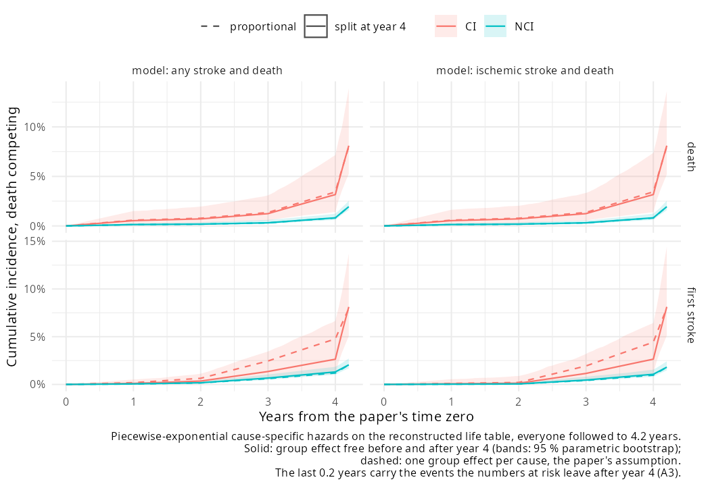

::: {.callout-note appearance="simple"}
**Paper reviewed.** Shi Z., Wang A., Meng X., Tian X., Sun Y., Li J., Zhang X., Han X. (2026). *Baseline cognitive impairment predicts cerebrovascular events in stroke-free chinese adults*. Scientific Reports. [doi:10.1038/s41598-026-78298-4](https://doi.org/10.1038/s41598-026-78298-4).
Version: Article in Press (typeset accepted manuscript). Protocol version `{r} params$protocol_version`,
track `{r} params$track`. Corresponding author contacted on 2026-11-20 with a data request and notice of
this commentary; reply: pending (see [Right of reply](#right-of-reply)).
:::

## Summary

::: {.verdict}
**Verdict:** sound | minor concerns | major concerns | conclusions not supported.
Two or three sentences on why.
:::

```{r}
#| label: tbl-quality
#| tbl-cap: "Issues by protocol domain, from the registry. Rating rule (protocol H2): any critical issue, conclusions at risk; any major, major concerns; only minor, minor concerns; none, no concern found."
source(here::here("lib/quality_table.R"))
quality_table("P002") |> knitr::kable(format = "pipe", align = "lrrrrrrll")
```

## What the paper does

Design, sample, outcomes, primary analysis, in the authors' own terms.

## Design

## Measurement

## Model adequacy

## Internal consistency

```{r}
#| label: setup
#| message: false
source(here::here("lib/consistency.R"))
```

Recomputations from the reported numbers go here, each with a short interpretation and an
evidence tag, e.g.

::: {.evidence-confirmed}
The reported mean change does not equal the difference of the condition means.
:::

## Reporting

## Do the conclusions follow?

## Re-analysis

```{r}
#| label: reanalysis-setup
#| message: false
#| warning: false
library(readr); library(dplyr); library(knitr)
art <- here::here("SciRep_cognitive_impairment_cerebrovascular_events_Shi_2026")
rd  <- function(p) read_csv(file.path(art, p), show_col_types = FALSE, progress = FALSE)
f   <- function(x, d = 2) formatC(round(x, d), format = "f", digits = d)
kb  <- function(x, align = NULL, min_width = 11) { names(x) <- formatC(names(x), width = min_width, flag = "-"); kable(x, format = "pipe", align = align) }
t1   <- rd("data/raw/table1_baseline.csv")
age_gap <- t1$ci_med[t1$variable == "Age"] - t1$nci_med[t1$variable == "Age"]
t2   <- rd("data/raw/table2_cox.csv")
T2   <- function(o, g, w) t2[[w]][t2$outcome == o & t2$group == g]
ce   <- rd("output/tables/stage2_curves_at_end.csv")
CE   <- function(o, g, w, sc = "early", tm = 4.2) ce[[w]][ce$outcome == o & ce$group == g & ce$scenario == sc & ce$time == tm]
tl   <- rd("output/tables/stage3_e1_tail.csv") |> filter(scenario == "uniform")
chk  <- rd("output/tables/stage3_checks.csv")
scr  <- rd("output/tables/stage3_e3_screening.csv")
sbs  <- rd("output/tables/stage4_side_by_side.csv")
conv <- rd("output/tables/stage4_convergence.csv")
ppc  <- rd("output/tables/stage4_ppc.csv")
pp   <- rd("output/tables/stage4_prior_predictive.csv") |> filter(quantity %in% c("events per cell", "events per group"))
mapc <- rd("output/tables/stage4_mapping_checks.csv")
# one row of the side-by-side table (stage 2, 3 and 4 per estimand; R/03_postprocess.R); stops unless exactly one row matches
m_ <- function(col, v) if (is.null(v)) rep(TRUE, length(col)) else (!is.na(col) & col == v)
R4 <- function(run, quantity, outcome = NULL, group = NULL, time = NULL, period = NULL, rule = NULL) {
  r <- sbs[sbs$run == run & sbs$quantity == quantity & m_(sbs$outcome, outcome) & m_(sbs$group, group) &
           m_(sbs$time, time) & m_(sbs$period, period) & m_(sbs$rule, rule), ]
  stopifnot(nrow(r) == 1)
  r
}
# estimate [lo, hi] from the paper, stage 3 or stage 4 columns of such a row; k rescales (100 = per 100 people)
iv <- function(r, p = "stage4", d = 2, k = 1) {
  est <- if (p == "stage4") "stage4_median" else p
  if (is.na(r[[est]])) return("—")
  sprintf("%s [%s, %s]", f(k * r[[est]], d), f(k * r[[paste0(p, "_lo")]], d), f(k * r[[paste0(p, "_hi")]], d))
}
OL  <- c("ischemic stroke" = "ischaemic stroke", "any stroke" = "any stroke", "all-cause mortality" = "death")
E1  <- list(c("isch", "ischemic stroke"), c("any", "any stroke"), c("isch", "all-cause mortality"))   # pem run, cause
E2  <- list(c("isch", "ischemic stroke"), c("any", "any stroke"), c("death", "all-cause mortality"))  # exposure run, outcome
HRA <- "HR at given age and sex"
TH  <- "hazard multiplier per decade of age"
th3 <- function(r) sub(".*\\(([0-9.]+)\\).*", "\\1", r$stage3_source)                # the age effect the stage 3 fit was fixed at
shr <- sbs |> filter(estimand == "E1b", run %in% c("isch", "any")) |> pull(ratio_4_over_3)
shw <- sbs |> filter(estimand == "E1b", run %in% c("isch_bsd2", "any_bsd2")) |> pull(ratio_4_over_3)
```

### Data

The authors' data were requested on 2026-11-20 and had not arrived when this was written. Everything
below runs on a reconstruction with two parts, logged in `data/derived/RECONSTRUCTION_LOG.md`.

1. **A life table.** The numbers at risk under Figure 2 give the removals per year and group; with
   Table 2 they split into strokes and deaths. The events Table 2 counts beyond those removed by
   year 4 must fall between year 4 and the end of the axis at 4.2 years. Assumptions: nobody is
   censored before year 4 (the paper reports no loss to follow-up), deaths before year 4 occur in
   people without a prior stroke, and no person carries both a stroke and a death. Event times
   within a year are unknown, so person-years are computed three ways (events spread uniformly, at
   the start, at the end of each interval); "uniform" is the main scenario.
2. **A calibrated population.** 3,875 people with the group sizes of Table 2, the sex shares of
   Table 1 and ages drawn from a distribution fitted to the Table 1 median and quartiles of each
   group, truncated at 90 years (80 and 100 as sensitivity). It carries no events: it is used to
   ask what hazard ratio at equal age and sex reproduces the Table 2 counts for a given age effect.

All results of this section are therefore *inferred*: they hold for the paper's published numbers
under the stated assumptions, and the authors' data would replace them.

### Stage 2: the paper's analysis on the reconstruction

The unadjusted Cox models refitted on the reconstructed life table return the hazard ratios of
Table 2 to within `{r} f(max(abs(sbs$stage2[sbs$estimand == "E1b" & sbs$run %in% c("isch", "any")] - sbs$paper[sbs$estimand == "E1b" & sbs$run %in% c("isch", "any")])), 2)`
(@tbl-e1b, second and third columns), so the reconstruction carries the information the paper's
unadjusted analysis used. The same life table gives curves that end at
`{r} f(100 * CE("ischemic stroke", "CI", "one_minus_km"), 1)` % (MMSE < 24) and
`{r} f(100 * CE("ischemic stroke", "NCI", "one_minus_km"), 1)` % (MMSE ≥ 24) for ischaemic stroke, where
Figure 2 draws `{r} f(CE("ischemic stroke", "CI", "fig2_final_value"), 2)` and
`{r} f(CE("ischemic stroke", "NCI", "fig2_final_value"), 2)` on an axis labelled cumulative incidence.

{#fig-km-recon}

### Stages 3 and 4: the same two models, twice

Two models, each fitted by maximum likelihood (stage 3, `R/06_fit_frequentist.R`) and in Stan
(stage 4, `stan/`, `R/03_postprocess.R`), specified before fitting in `notes/04_analysis_plan.md`
and written out in [the next section](#what-this-review-fits).

- **E1**: cause-specific hazards of stroke and death, constant within each interval of the life
  table, with one group coefficient per cause; in a second structure the group coefficient has one
  value before year 4 and one after. From it: hazard ratios, cumulative incidences with death
  competing, risk differences and ratios, and the ratio of the event rate in the last 0.2 years to
  the rate before.
- **E2**: on the calibrated population, the hazard ratio for MMSE < 24 at equal age and sex that
  reproduces the two event counts of Table 2, given a hazard multiplier per decade of age. Stage 3
  fixes the age effect; stage 4 gives it one of three priors: P1 centred at 1.55 (the value at
  which the model returns the paper's Model 1 for the two stroke outcomes), P2 centred at 2
  (stroke incidence is commonly reported to double per decade of age [@kellyhayes2010]), P3 uniform
  on the log scale between 1 and 3.

Priors for stage 4: log hazard per interval Normal(log 0.005, 1.5); group coefficients Normal(0, 1),
with Normal(0, 2) as sensitivity; in E2 male sex Normal(log 1.3, 0.15).

**Sampler and fit.** `{r} sum(conv$passes)` of `{r} nrow(conv)` runs meet the thresholds set in the
plan (largest R-hat `{r} f(max(conv$max_rhat), 3)`, smallest bulk effective sample size
`{r} f(min(conv$min_ess_bulk), 0)`, `{r} sum(conv$divergences)` divergent transitions).
`{r} sum(ppc$covers)` of `{r} nrow(ppc)` observed counts lie inside the central 95 % of their
posterior predictive distribution. The quantities Stan generates were recomputed in R from the
parameter draws: `{r} sum(mapc$pass)` of `{r} nrow(mapc)` checks agree, largest difference
`{r} formatC(max(mapc$max_diff), format = "e", digits = 0)`. Before the data were used,
`{r} sum(pp$covers)` of `{r} nrow(pp)` observed counts lay inside the prior predictive 95 %; the
exceptions are cells of the last interval and one empty cell, and the prior was kept as written.

#### E1: unadjusted hazard ratios and their time pattern

```{r}
#| label: tbl-e1b
#| tbl-cap: "Unadjusted cause-specific hazard ratios, MMSE < 24 against ≥ 24, with 95 % intervals. Stage 2: Cox on the reconstructed life table. Stage 3: piecewise-exponential model, Wald interval. Stage 4: posterior median and 95 % interval under two priors on the log hazard ratio."
lapply(E1, \(x) {
  r <- R4(x[1], "HR", x[2]); w <- R4(paste0(x[1], "_bsd2"), "HR", x[2])
  tibble(Outcome = OL[[x[2]]], `Paper, Table 2` = iv(r, "paper"), `Stage 2` = f(r$stage2), `Stage 3` = iv(r, "stage3"),
         `Stage 4, Normal(0, 1)` = iv(r), `Stage 4, Normal(0, 2)` = iv(w))
}) |> bind_rows() |> kb(align = "lrrrrr")
```

::: {.evidence-inferred}
The piecewise-exponential model returns the paper's unadjusted hazard ratios. The posterior medians
are `{r} f(100 * (1 - max(shr)), 0)` to `{r} f(100 * (1 - min(shr)), 0)` % below the stage 3 estimates
under Normal(0, 1) and `{r} f(100 * (1 - max(shw)), 0)` to `{r} f(100 * (1 - min(shw)), 0)` % below under
Normal(0, 2): with 15 events in the impaired group, a prior that doubts a fourfold ratio moves the
estimate, more than the "few percent" the plan expected. The difference is the prior's and is
reported as such; no conclusion below depends on it.
:::

```{r}
#| label: tbl-split
#| tbl-cap: "The group hazard ratio estimated separately before and after year 4 (main scenario). Pr: posterior probability that the hazard ratio exceeds 1, under Normal(0, 1)."
lapply(E1, \(x) lapply(c("(0, 4]", "(4, 4.2]"), \(p) {
  r <- R4(paste0(x[1], "_split"), "HR", x[2], period = p); w <- R4(paste0(x[1], "_split_bsd2"), "HR", x[2], period = p)
  tibble(Outcome = OL[[x[2]]], Years = p, `Stage 3` = iv(r, "stage3"), `Stage 4, Normal(0, 1)` = iv(r),
         `Pr(HR > 1)` = f(r$pr_gt_1, 2), `Stage 4, Normal(0, 2)` = iv(w))
}) |> bind_rows()) |> bind_rows() |> kb(align = "llrrrr")
```

```{r}
#| label: tbl-tail
#| tbl-cap: "Events and event rates in the last 0.2 years of the axis against the four years before (main scenario; model with the group effect split at year 4). Ratio: rate in (4, 4.2] over rate in (0, 4]; 1 means a constant rate. Stage 3: crude rates with a Wald interval."
lapply(E1, \(x) lapply(c("NCI", "CI"), \(g) {
  cs <- if (x[2] == "all-cause mortality") "death" else "stroke"
  a <- tl[tl$model == x[1] & tl$cause == cs & tl$group == g, ]; stopifnot(nrow(a) == 1)
  r <- R4(paste0(x[1], "_split"), "tail ratio", x[2], group = g)
  tibble(Outcome = OL[[x[2]]], Group = if (g == "CI") "MMSE < 24" else "MMSE ≥ 24", `Events, years 0–4` = a$events_pre,
         `Events, last 0.2 years` = a$events_tail, `Ratio, stage 3` = iv(r, "stage3", 0), `Ratio, stage 4` = iv(r, d = 0))
}) |> bind_rows()) |> bind_rows() |> kb(align = "llrrrr")
```

::: {.evidence-inferred}
The numbers at risk place `{r} tl$events_tail[tl$model == "isch" & tl$cause == "stroke" & tl$group == "CI"]` of the
`{r} T2("ischemic stroke", "CI", "events")` ischaemic strokes of the impaired group, and
`{r} tl$events_tail[tl$model == "isch" & tl$cause == "stroke" & tl$group == "NCI"]` of the
`{r} T2("ischemic stroke", "NCI", "events")` of the other group, in the last 0.2 years of follow-up: event
rates `{r} f(min(sbs$stage4_median[sbs$quantity == "tail ratio" & sbs$run %in% c("isch_split", "any_split")]), 0)` to
`{r} f(max(sbs$stage4_median[sbs$quantity == "tail ratio" & sbs$run %in% c("isch_split", "any_split")]), 0)` times
those of the first four years. No cohort produces this unless event dates were assigned near the end
of follow-up, or the numbers at risk are not those of the analysed data. Before year 4 the
ischaemic-stroke hazard ratio is `{r} iv(R4("isch_split", "HR", "ischemic stroke", period = "(0, 4]"))`,
with an interval that includes 1; after year 4 it is
`{r} iv(R4("isch_split", "HR", "ischemic stroke", period = "(4, 4.2]"))`. The group contrast of Table 2
rests mostly on the events without a plausible date. What dataset the figure was drawn from is the
first question for the authors.
:::

#### E1: absolute risks with death competing

```{r}
#| label: tbl-cif
#| tbl-cap: "First events per 100 people by year 4 and by 4.2 years, with death as a competing event (stage 4, person-years of the early scenario, group effect split at year 4; posterior median and 95 % interval). Difference and ratio: MMSE < 24 against ≥ 24."
lapply(E1, \(x) lapply(c(4, 4.2), \(tm) {
  run <- paste0(x[1], "_early_split")
  rdf <- R4(run, "RD", x[2], time = tm)
  tibble(Outcome = OL[[x[2]]], `By year` = f(tm, 1), `MMSE ≥ 24` = iv(R4(run, "F", x[2], group = "NCI", time = tm), d = 1, k = 100),
         `MMSE < 24` = iv(R4(run, "F", x[2], group = "CI", time = tm), d = 1, k = 100),
         `Difference, stage 3` = iv(rdf, "stage3", 1, 100), `Difference, stage 4` = iv(rdf, d = 1, k = 100),
         `Ratio, stage 4` = iv(R4(run, "RR", x[2], time = tm), d = 1))
}) |> bind_rows()) |> bind_rows() |> kb(align = "llrrrrr")
```

{#fig-cif}

::: {.evidence-inferred}
Over the whole follow-up the model gives
`{r} f(100 * R4("isch_early_split", "F", "ischemic stroke", group = "CI", time = 4.2)$stage4_median, 1)` first
ischaemic strokes per 100 people with MMSE < 24 against
`{r} f(100 * R4("isch_early_split", "F", "ischemic stroke", group = "NCI", time = 4.2)$stage4_median, 1)` per 100
with MMSE ≥ 24: a difference of `{r} iv(R4("isch_early_split", "RD", "ischemic stroke", time = 4.2), d = 1, k = 100)`
per 100 (stage 3, without a prior: `{r} iv(R4("isch_early_split", "RD", "ischemic stroke", time = 4.2), "stage3", 1, 100)`),
before any adjustment for the `{r} f(age_gap, 1)` years of age between the groups. This is the
size of what the paper calls "2.32 to 2.55 times higher risk". By year 4, the last point the numbers
at risk fix, the difference is `{r} iv(R4("isch_early_split", "RD", "ischemic stroke", time = 4), d = 1, k = 100)`
per 100 and its interval includes zero. Figure 2 shows none of these quantities.
:::

#### E2: the hazard ratio at equal age and sex depends on the age effect

```{r}
#| label: tbl-e2
#| tbl-cap: "Hazard ratio for MMSE < 24 between people of the same age and sex, by assumption on the age effect (calibrated population, age ceiling 90). Age effect: posterior median and 95 % interval of the hazard multiplier per decade (the data do not inform it; this is the prior). Stage 3: the age effect fixed at the value shown, profile-likelihood interval. Stage 4: posterior median and 95 % interval; Pr: posterior probability that the hazard ratio exceeds 1."
lapply(E2, \(x) lapply(c("P1", "P2", "P3"), \(p) {
  run <- paste0(x[1], "_", p); r <- R4(run, HRA)
  tibble(Outcome = OL[[x[2]]], Prior = p, `Age effect per decade` = iv(R4(run, TH)),
         `Stage 3` = if (is.na(r$stage3)) "—" else paste0(iv(r, "stage3"), " at ", th3(r)),
         `Stage 4` = iv(r), `Pr(HR > 1)` = f(r$pr_gt_1, 2))
}) |> bind_rows()) |> bind_rows() |> kb(align = "llrrrr")
```

{#fig-hr-prior}

::: {.evidence-inferred}
The paper's Model 1 gives `{r} f(R4("isch_P2", HRA)$paper)` (ischaemic stroke),
`{r} f(R4("any_P2", HRA)$paper)` (any stroke) and `{r} f(R4("death_P2", HRA)$paper)` (death) without
reporting the age coefficient that produces them. On the calibrated population those values require
that a decade of age multiplies the hazard by about `{r} th3(R4("isch_P1", HRA))` for the stroke
outcomes. If the multiplier is 2, the ischaemic-stroke hazard ratio is `{r} iv(R4("isch_P2", HRA))`, and
for any stroke `{r} iv(R4("any_P2", HRA))`; both intervals include 1. With the age effect left
unknown between 1 and 3 (P3) the ischaemic-stroke ratio is `{r} iv(R4("isch_P3", HRA))`. The paper's
numbers support "independently forecasted" only for a reader who accepts an age effect near 1.5 per
decade in this cohort; the paper does not report it. Moving the age ceiling to 80 or 100 years gives
`{r} f(R4("isch_P2_amax80", HRA)$stage4_median)` and `{r} f(R4("isch_P2_amax100", HRA)$stage4_median)`
under P2. For death the paper's Model 1 corresponds to a larger age effect, so P1 is not "what
Model 1 implies" for that outcome and the death row under P1 is shown for completeness only.
Education, which the paper also adjusts for and which differs between the groups, is not in this
model; adding it could only lower the ratio further.
:::

#### E3: what a positive screen adds to knowing the age

```{r}
#| label: tbl-e3
#| tbl-cap: "From the E2 model (stage 4, posterior median and 95 % interval). Age-equivalent: the years of age that carry the same hazard as MMSE < 24. c-index: probability that a future case is ranked above a non-case by 4.2-year risk (0.5 chance, 1 perfect), from age and sex, and the gain from adding MMSE status."
lapply(E2, \(x) lapply(c("P1", "P2", "P3"), \(p) {
  run <- paste0(x[1], "_", p)
  tibble(Outcome = OL[[x[2]]], Prior = p, `Age-equivalent, years` = iv(R4(run, "age-equivalent, years"), d = 0),
         `c-index, age and sex` = iv(R4(run, "c_age_sex")), `Gain from MMSE` = iv(R4(run, "c_gain"), d = 3))
}) |> bind_rows()) |> bind_rows() |> kb(align = "llrrr")
```

```{r}
#| label: tbl-e3c
#| tbl-cap: "Three ways of flagging people for a first stroke within 4.2 years, on the calibrated population under P2 (stage 4, posterior median and 95 % interval). Sensitivity: future cases flagged, per 100 cases. Positive predictive value: cases per 100 people flagged."
RULE <- c("MMSE < 24" = "MMSE < 24", "age >= 65" = "age ≥ 65", "MMSE < 24 or age >= 65" = "MMSE < 24 or age ≥ 65")
lapply(E2[1:2], \(x) lapply(names(RULE), \(ru) {
  run <- paste0(x[1], "_P2")
  tibble(Outcome = OL[[x[2]]], `Flag rule` = RULE[[ru]], Sensitivity = iv(R4(run, "sensitivity", rule = ru), d = 0, k = 100),
         `Positive predictive value` = iv(R4(run, "ppv", rule = ru), d = 1, k = 100),
         Specificity = iv(R4(run, "specificity", rule = ru), d = 0, k = 100))
}) |> bind_rows()) |> bind_rows() |> kb(align = "llrrr")
```

::: {.evidence-inferred}
The MMSE flags `{r} T2("ischemic stroke", "CI", "events")` of the `{r} T2("ischemic stroke", "overall", "events")`
people who went on to an ischaemic stroke: a sensitivity of
`{r} f(100 * scr$estimate[scr$outcome == "ischemic stroke" & scr$source == "observed, Table 2 counts" & scr$metric == "sensitivity"], 0)` %,
from the paper's own counts. In the calibrated population under P2 the rule "age ≥ 65" flags
`{r} f(100 * R4("isch_P2", "sensitivity", rule = "age >= 65")$stage4_median, 0)` % of future cases, and adding
MMSE < 24 to it brings that to `{r} f(100 * R4("isch_P2", "sensitivity", rule = "MMSE < 24 or age >= 65")$stage4_median, 0)` %.
The c-index of age and sex is `{r} f(R4("isch_P2", "c_age_sex")$stage4_median)` and MMSE status adds
`{r} f(R4("isch_P2", "c_gain")$stage4_median, 3)`. Under P2 an MMSE below 24 carries the hazard of being
`{r} f(R4("isch_P2", "age-equivalent, years")$stage4_median, 0)` years older, with an interval from
`{r} f(R4("isch_P2", "age-equivalent, years")$stage4_lo, 0)` to `{r} f(R4("isch_P2", "age-equivalent, years")$stage4_hi, 0)`
years. Under P3 the upper limits of the age-equivalent are not interpretable: the quantity divides
by the log of the age effect, which P3 allows to be close to zero. The paper's sentence that
"cognitive screening could be valuable for identifying stroke-free adults who are at a greater risk"
has no estimate behind it; on the published numbers the date of birth identifies more of them.
:::

## The models, written out

Protocol H4. What the paper fitted, in notation, with what each parameter is and what the paper
reads it as; what its p-values test; the structure of the question as a diagram; and the models of
the re-analysis in the same notation. Drafted in `notes/04_analysis_plan.md`, section 3b.

```{r}
#| label: models-setup
#| message: false
library(readr); library(dplyr)
art <- here::here("SciRep_cognitive_impairment_cerebrovascular_events_Shi_2026")
rd  <- function(p) read_csv(file.path(art, p), show_col_types = FALSE, progress = FALSE)
f   <- function(x, d = 2) formatC(round(x, d), format = "f", digits = d)
t1  <- rd("data/raw/table1_baseline.csv")
t2  <- rd("data/raw/table2_cox.csv")
T2  <- function(o, g, w) t2[[w]][t2$outcome == o & t2$group == g]
ce  <- rd("output/tables/stage2_curves_at_end.csv")
CE  <- function(o, g, w, sc = "early", tm = 4.2) ce[[w]][ce$outcome == o & ce$group == g & ce$scenario == sc & ce$time == tm]
risk_ci  <- T2("ischemic stroke", "CI", "events") / T2("ischemic stroke", "CI", "n_group")
risk_nci <- T2("ischemic stroke", "NCI", "events") / T2("ischemic stroke", "NCI", "n_group")
n_tests  <- sum(!is.na(t1$p_reported))
age_gap  <- t1$ci_med[t1$variable == "Age"] - t1$nci_med[t1$variable == "Age"]
```

### What the paper fits

One Cox proportional-hazards model per outcome $k \in \{$ischaemic stroke, any stroke, death$\}$
and per covariate set $z$:

$$h_k(t \mid \mathrm{CI}_i, z_i) = h_{0k}(t)\, \exp\!\big(\beta_k\, \mathrm{CI}_i + \gamma_k^{\top} z_i\big),$$

with $z$ empty (unadjusted), $z = ($age, gender, education$)$ (Model 1), and $z$ plus
homocysteine, intracranial stenosis, hypertension and occupation (Model 2). The paper reports
$\exp(\hat\beta_k)$ with a Wald interval. It does not report $h_{0k}$, which the partial
likelihood profiles out, nor any $\gamma_k$.

**What $\exp(\beta_k)$ is.** The ratio of the cause-specific hazards, the instantaneous rate of
a first event of type $k$ among people still event-free, between a person with MMSE < 24 and one
with MMSE ≥ 24 and the same $z$, assumed constant over $t$; $t$ runs from an origin the paper
does not state; the comparison is made in the participants with complete $z$ (an unstated
number for Model 2), and death is treated as independent censoring in the stroke models.

**What the paper reads it as.** "A 2.32 to 2.55 times higher risk" (Discussion). A hazard
ratio is not a risk ratio. The share of a group with a first ischaemic stroke by time $t$ is

$$F_g(t) = \int_0^{t} S_g(u)\, h_g(u)\, du, \qquad S_g(u) = \exp\!\Big(-\sum_{k'} \int_0^{u} h_{gk'}(v)\, dv\Big),$$

which needs the baseline and the death hazard the paper does not give. From the counts of
Table 2 it is `{r} f(100 * risk_ci, 1)` % against `{r} f(100 * risk_nci, 1)` % over the follow-up:
a risk ratio of `{r} f(risk_ci / risk_nci, 1)` and `{r} f(100 * (risk_ci - risk_nci), 0)` more
first strokes per 100 people, before any adjustment.

**How age enters.** Presumably as $\gamma_{\text{age}}\, \text{age}_i$ on the log hazard, so
that each decade multiplies the hazard by $\theta_{\text{age}} = \exp(10\gamma_{\text{age}})$,
the same factor at 45 and at 75. With rare events the unadjusted and adjusted coefficients obey

$$\mathrm{HR}_{\text{crude}} \approx \exp(\beta_k) \times
\frac{\mathbb{E}\big[\exp(\gamma_k^{\top} z) \mid \mathrm{CI} = 1\big]}{\mathbb{E}\big[\exp(\gamma_k^{\top} z) \mid \mathrm{CI} = 0\big]},$$

the second factor being how much more hazard the exposed group carries through $z$ alone. The
paper gives the left side (`{r} f(T2("ischemic stroke", "CI", "hr_unadj"))`) and $\exp(\hat\beta_k)$
(`{r} f(T2("ischemic stroke", "CI", "hr_m1"))`) and so fixes this factor at
`{r} f(T2("ischemic stroke", "CI", "hr_unadj") / T2("ischemic stroke", "CI", "hr_m1"))` without saying
what $\gamma_k$ produces it, in a comparison where the groups differ by `{r} f(age_gap, 1)` years at
the median. The re-analysis inverts this identity (E2 below).

**The curves.** Figure 2 draws $1 - \hat S_{gk}(t)$ with
$\hat S_{gk}(t) = \prod_{t_j \le t} (1 - d_{gkj}/n_{gj})$ and calls it cumulative incidence. With
death competing, the share with a stroke by $t$ is $F_g(t)$ above (the Aalen–Johansen estimate),
and $F_g(t) \le 1 - \hat S_{g,\text{stroke}}(t)$. On the reconstruction the gap at the end of the
axis is `{r} f(CE("ischemic stroke", "CI", "one_minus_km") - CE("ischemic stroke", "CI", "aalen_johansen"), 3)`
for the impaired group: negligible in size, but the label names a different quantity.

**What the p-values test.** Each answers "if $H_0$ held, how often would data at least this far
from it arise"; none estimates anything the conclusion needs.

| where | $H_0$ in symbols | was $H_0$ the question? | what the number stands in front of |
|---|---|---|---|
| Table 1, `{r} n_tests` rows | $F_v^{\mathrm{CI}} = F_v^{\mathrm{NCI}}$ for each baseline variable $v$ | no: two groups defined by cognition differ in age by construction; the question is by how much and what it does to $\beta_k$ | the size of each difference and its consequence; used instead to pick $z$ for Model 2 |
| Fig. 2, log-rank | $h_k^{\mathrm{CI}}(t) = h_k^{\mathrm{NCI}}(t)$ for all $t$ | no: that older, less schooled people have more strokes was not in doubt | the curves, which contradict the table |
| Methods, proportional hazards | $\beta_k(t) = \beta_k$ | a model check, legitimate in itself | with 15 exposed events the test sees gross departures only; "P > 0.05" is not evidence of proportionality |
| Table 2, interval edges | $\beta_k = 0$ at the edge | the interval is the useful part; its width is set by 15 events | — |

### What the design identifies

```{r}
#| label: dag-p002
#| include: false
# causal structure of the question (plan §3b.4, every edge sourced there); only the computed sets are quoted below
library(dagitty); library(ggdag); library(ggplot2)
dag_txt <- '
dag {
  CI      [exposure, pos="1.45,0.92"]
  Stroke  [outcome,  pos="2.89,0.97"]
  Death   [pos="4.91,0.33"]
  AgeSex  [pos="3.2,3.27"]
  Edu     [pos="0.45,3.36"]
  Occ     [pos="-1,2.14"]
  Vasc    [pos="2.63,1.94"]
  U       [latent, pos="1.91,0.21"]
  S       [adjusted, pos="-0.95,-0.13"]
  AgeSex -> CI  AgeSex -> Stroke  AgeSex -> Death  AgeSex -> Vasc  AgeSex -> S
  Edu -> CI  Edu -> Stroke  Edu -> Occ  Edu -> S
  Occ -> Vasc
  Vasc -> CI  Vasc -> Stroke  Vasc -> Death  Vasc -> S
  U -> CI  U -> Stroke
  CI -> Stroke  CI -> Death
  Stroke -> Death
}'
g <- dagitty(dag_txt)
g_noU <- dagitty(paste(grep("\\bU\\b", strsplit(dag_txt, "\n")[[1]], value = TRUE, invert = TRUE), collapse = "\n"))
# S is conditioned on by design and dagitty lists it in every set; shown separately in the text
fmt_sets <- function(s) {
  s <- lapply(s, \(v) sub("AgeSex", "Age, Sex", setdiff(v, "S")))
  if (length(s) == 0) "none" else paste(sapply(s, \(v) paste0("{", paste(v, collapse = ", "), "}")), collapse = "; ")
}
```

From the causal structure written in the plan (section 3b.4: age and sex, education, occupation, the
vascular factors measured in 2010/11, an unmeasured node U for cerebrovascular disease already under way,
and the selection S into the analysed sample), with the adjustment sets computed by dagitty rather than asserted:

- Without U, the minimal set that identifies the total effect of CI on stroke, besides S, is
  `{r} fmt_sets(adjustmentSets(g_noU, "CI", "Stroke", type = "minimal"))`. Model 1 leaves the
  vascular factors open; Model 2 adds three of them and occupation, which the graph does not
  require once they are in, and is fitted on the subset with occupation recorded.
- With U, the adjustment sets are `{r} fmt_sets(adjustmentSets(g, "CI", "Stroke", type = "minimal"))`:
  no choice of the measured covariates identifies an effect of cognition on stroke if low MMSE
  scores and later strokes share a cause in cerebrovascular disease already under way. This does
  not touch the paper's analysis; it touches its wording. "Independently forecasted" is a
  prediction claim, which U leaves intact; "cognitive impairment … heightens the risk" is a
  causal one, which U does not allow.
- Conditioning on S opens no path in this graph, but it changes the population: the estimates
  are for people who reached the 2012/13 visit event-free and completed an MMSE, and the paper
  reads them as for stroke-free adults aged 40 and over.
- Death is a competing event, not a confounder: the stroke hazard ratio is cause-specific under
  any adjustment, and the cumulative incidence needs the death hazard.
- The time origin is not a graph edge. If follow-up starts at the 2010/11 baseline while exposure
  is measured in 2012/13, the two years before the MMSE are immortal time for the exposed group.

### What this review fits

**E1, cause-specific piecewise-exponential hazards**, on the reconstructed life table. Intervals
$I_j$, $j = 1..5$: (0, 1], (1, 2], (2, 3], (3, 4], (4, 4.2]; causes $k \in \{$stroke, death$\}$;
groups $g$. In $I_j$ the hazard is constant:

$$h_{gk}(t) = \exp\!\big(\alpha_{jk} + \beta_k\, \mathrm{CI}_g\big), \quad t \in I_j; \qquad
D_{gjk} \sim \mathrm{Poisson}\!\big(\mathrm{PY}_{gj}\, h_{gk}\big).$$

This is the paper's unadjusted Cox model with $h_{0k}$ a step function that is estimated instead of
profiled out. $\beta_k$ has the same meaning as the paper's, and because $\alpha_{jk}$ is estimated
the model also gives absolute quantities. With $S_g(t_{j-1})$ the probability of being event-free
at the start of $I_j$, $h_{g\cdot} = \sum_k h_{gk}$ and $\Delta_j = |I_j|$,

$$F_{gk}(t_j) = F_{gk}(t_{j-1}) + S_g(t_{j-1})\, \frac{h_{gk}}{h_{g\cdot}}\, \big(1 - e^{-h_{g\cdot}\Delta_j}\big),
\qquad S_g(t_j) = S_g(t_{j-1})\, e^{-h_{g\cdot}\Delta_j}.$$

Derived: $F_{gk}(4)$ and $F_{gk}(4.2)$; $\mathrm{RD}_k = F_{1k} - F_{0k}$; $\mathrm{RR}_k = F_{1k}/F_{0k}$;
the tail ratio, the hazard in $I_5$ over the person-time-weighted mean hazard in $I_1..I_4$; and,
in the second structure, $\beta_k^{(0\text{–}4)}$ and $\beta_k^{(4\text{–}4.2)}$ in place of $\beta_k$.
Stage 4 priors: $\alpha_{jk} \sim \mathrm{N}(\log 0.005, 1.5)$, $\beta \sim \mathrm{N}(0, 1)$.

Limitations: the cells come from a reconstruction; the intervals are the figure's, not chosen by
the data; $\beta_k$ is unadjusted, because the reconstruction has no covariates; a constant hazard
within a year is a coarse step; the model inherits the paper's time origin, whatever it is.

**E2, the exposure effect given an age effect**, on the calibrated population. For person $i$ with
age $a_i$ (decades from 50), sex $m_i$, group $g_i$, and follow-up $\tau = 4.1$ years:

$$\mu_i = 1 - \exp\!\big(-\tau\, \lambda_0\, e^{\,\beta_{\mathrm{CI}} \mathrm{CI}_i + \beta_{\text{age}} a_i + \beta_{m} m_i}\big),
\qquad D_g \sim \mathrm{Poisson}\Big(\sum_{i \in g} \mu_i\Big).$$

Two counts and, once $(\beta_{\text{age}}, \beta_m)$ are given, two free parameters
$(\lambda_0, \beta_{\mathrm{CI}})$: the likelihood is saturated, and $\exp(\beta_{\mathrm{CI}})$ is
the paper's Model 1 quantity, the hazard ratio between two people of the same age and sex, as a
function of $\theta_{\text{age}} = e^{\beta_{\text{age}}}$, the hazard multiplier per decade. Stage 3
fixes $\theta_{\text{age}}$ on a grid; stage 4 gives it a prior and integrates. The model adds no
information to the paper's numbers: it makes visible the assumption the adjusted estimate rests on.
Stage 4 priors: $\lambda_0 \sim \mathrm{LogN}(\log 0.004, 1.5)$, $\beta_{\mathrm{CI}} \sim \mathrm{N}(0, 1)$,
$\beta_m \sim \mathrm{N}(\log 1.3, 0.15)$; $\beta_{\text{age}} \sim \mathrm{N}(\log 1.55, 0.10)$ (P1),
$\mathrm{N}(\log 2, 0.15)$ (P2) or $\mathrm{Uniform}(0, \log 3)$ (P3).

Limitations: ages are a fitted distribution, not data; education, correlated with age, is not in
the model; sex is independent of age within group by assumption; the hazard is constant over the
follow-up.

**E3, derived from E2.** Age-equivalent $\Delta a = 10\,\beta_{\mathrm{CI}}/\beta_{\text{age}}$ years.
With $r_i$ the 4.2-year risk of person $i$, the c-index of a ranking is
$\Pr(r_i > r_j \mid i \text{ case}, j \text{ non-case})$, computed from age and sex alone and from
age, sex and MMSE status. Sensitivity, specificity and predictive values at 4.2 years come from the
same $r_i$ and a flag rule (MMSE < 24; age ≥ 65; either).

The two Bayesian programs, drawn from the Stan files (@fig-model-dags-p002):

```{r}
#| label: fig-model-dags-p002
#| message: false
#| fig-width: 6.5
#| fig-height: 4
#| fig-dpi: 150
#| layout-ncol: 2
#| fig-subcap:
#|   - "E1, cause-specific piecewise-exponential hazards"
#|   - "E2, exposure effect given an age effect"
#| fig-cap: "The two Bayesian programs of stage 4, one node per quantity of the Stan file (`stan/pem_competing.stan`, `stan/exposure_age.stan`): prior constants (yellow, beside the node), parameters (green), derived quantities (grey), covariates (blue), data (red). Left: cause-specific piecewise-exponential hazards, g group, j interval, k cause; the hazard ratio, the ratio of the last interval's hazard to the earlier ones (tail), the cumulative incidences F and their contrasts are generated quantities; in the variant with the group effect split at year 4 the coefficient has one value before and one after. Right: the exposure effect given an age effect, i person in the calibrated population, g group; the prior on the age coefficient is one of P1, P2, P3; μ is the probability of an event within the 4.1 years of follow-up and r the 4.2-year risk, from the same hazard; the hazard ratio, the age-equivalent Δa, the c-index and the screening metrics are generated quantities."
source(here::here("lib/model_dag.R"))
N <- function(m, s) sprintf("N*'(%s, %s)'", m, s)
pem_nodes <- data.frame(
  name  = c("ha", "hb", "alpha", "beta", "ci", "py", "h", "D", "hr", "tail", "F", "RD"),
  label = c(N("log 0.005", 1.5), N(0, 1), "alpha[jk]", "beta[k]", "CI[g]", "PY[gj]", "h[gjk]", "D[gjk]", "HR[k]", "tail[gk]", "F[gjk]", "atop(scriptstyle(RD[k]), scriptstyle(RR[k]))"),
  group = c("hyperparameter", "hyperparameter", "parameter", "parameter", "covariate", "covariate", "derived", "observed", "derived", "derived", "derived", "derived"),
  x = c(0, 0, 1, 1, 2.1, 3.3, 3, 4.4, 1.9, 4.4, 4.4, 5.6), y = c(2.4, 1.4, 2.4, 1.4, 0.8, 3.1, 1.9, 2.4, 0.2, 1.4, 0.4, 0.4))
pem_edges <- data.frame(from = c("ha", "hb", "alpha", "beta", "ci", "h", "py", "beta", "h", "py", "h", "F"),
                        to   = c("alpha", "beta", "h", "h", "h", "D", "D", "hr", "tail", "tail", "F", "RD"))
ea_nodes <- data.frame(
  name  = c("hc", "hage", "hl", "hm", "bci", "bage", "l0", "bm", "ci", "a", "m", "mu", "E", "D", "hr", "da", "cs"),
  label = c(N(0, 1), "P[1]*', '*P[2]*', '*P[3]", "LogN*'(log 0.004, 1.5)'", "N*'(log 1.3, 0.15)'", "beta[CI]", "beta[age]", "lambda[0]", "beta[m]",
            "CI[i]", "a[i]", "m[i]", "atop(scriptstyle(mu[i]), scriptstyle(r[i]))", "E[g]", "D[g]", "HR[CI]", "Delta*a", "atop(scriptstyle(c), scriptstyle(sens))"),
  group = c(rep("hyperparameter", 4), rep("parameter", 4), rep("covariate", 3), "derived", "derived", "observed", "derived", "derived", "derived"),
  x = c(0, 0, 0, 0, 1, 1, 1, 1, 2.3, 3, 3.7, 3, 4.1, 5.2, 2, 2.9, 4.1),
  y = c(3, 2.2, 1.4, 0.6, 3, 2.2, 1.4, 0.6, 0.1, 0.1, 0.1, 1.8, 1.8, 1.8, 3.9, 3.9, 3.0))
ea_edges <- data.frame(from = c("hc", "hage", "hl", "hm", "bci", "bage", "l0", "bm", "ci", "a", "m", "mu", "E", "bci", "bci", "bage", "mu"),
                       to   = c("bci", "bage", "l0", "bm", "mu", "mu", "mu", "mu", "mu", "mu", "mu", "E", "D", "hr", "da", "da", "cs"))
model_dag(pem_nodes, pem_edges, "pem_competing.stan")
model_dag(ea_nodes, ea_edges, "exposure_age.stan")
```

### Parameters side by side

Values for ischaemic stroke; stage 4 posterior median and 95 % interval.

| symbol | the paper | this review | read as |
|---|---|---|---|
| $\exp(\beta_k)$, unadjusted | `{r} iv(R4("isch", "HR", "ischemic stroke"), "paper")`, Cox | `{r} iv(R4("isch", "HR", "ischemic stroke"))` | rate ratio between the groups among the event-free; includes the age difference |
| $\exp(\beta_k^{(0\text{–}4)})$, $\exp(\beta_k^{(4\text{–}4.2)})$ | one value; proportionality "met" | `{r} iv(R4("isch_split", "HR", "ischemic stroke", period = "(0, 4]"))` and `{r} iv(R4("isch_split", "HR", "ischemic stroke", period = "(4, 4.2]"))` | the same ratio before and after year 4 |
| $\exp(\alpha_{5k}) / \bar h_{k}$ | not reported | `{r} iv(R4("isch_split", "tail ratio", "ischemic stroke", group = "CI"), d = 0)` (MMSE < 24) | event rate of the last 0.2 years over the rate before; 1 is a constant rate |
| $1 - \hat S(t)$ | drawn to `{r} f(CE("ischemic stroke", "CI", "fig2_final_value"), 2)`, labelled cumulative incidence | $F_{gk}(4.2)$: `{r} iv(R4("isch_early_split", "F", "ischemic stroke", group = "CI", time = 4.2), d = 1, k = 100)` per 100 | share of the impaired group with a first stroke by 4.2 years, death competing |
| $\mathrm{RD}_k$ | not reported | `{r} iv(R4("isch_early_split", "RD", "ischemic stroke", time = 4.2), d = 1, k = 100)` per 100 | absolute excess over 4.2 years, unadjusted |
| $\theta_{\text{age}}$ | not reported | prior: `{r} iv(R4("isch_P1", TH))` (P1), `{r} iv(R4("isch_P2", TH))` (P2), `{r} iv(R4("isch_P3", TH))` (P3) | hazard multiplier per decade of age |
| $\exp(\beta_{\mathrm{CI}})$, adjusted | `{r} f(T2("ischemic stroke", "CI", "hr_m1"))` [`{r} f(T2("ischemic stroke", "CI", "hr_m1_lo"))`, `{r} f(T2("ischemic stroke", "CI", "hr_m1_hi"))`] (Model 1) | `{r} iv(R4("isch_P1", HRA))` (P1), `{r} iv(R4("isch_P2", HRA))` (P2), `{r} iv(R4("isch_P3", HRA))` (P3) | rate ratio at equal age and sex, conditional on the age effect one believes |
| $\Delta a$ | not reported | `{r} iv(R4("isch_P2", "age-equivalent, years"), d = 0)` years (P2) | years of age carrying the same hazard as MMSE < 24 |

## What the estimates mean

Protocol H3. Each row sets a number the paper reports beside the quantity the re-analysis estimates
for the same question, and says what each number is. The paper's values come from `data/raw/`, the
re-analysis values from `output/tables/` (stage 4 posterior median and 95 % interval; the stage 3
values are in the tables of the Re-analysis section). The reconstruction caveat of that section
applies to every right-hand cell. The headline quantity is an adjusted hazard ratio of 2.55 (1.33–4.87) for
ischaemic stroke, which the Discussion reads as "a 2.32 to 2.55 times higher risk". What it is: a
cause-specific hazard ratio, MMSE < 24 against ≥ 24, conditional on seven covariates, in the
participants with complete covariate data (an unstated number, at most about 2,740), over a time
scale whose origin is not stated, with death treated as censoring. The absolute figures behind it
are 15 of 192 against 66 of 3,683 events.

| Quantity | The paper reports | What that number is | Re-analysis | What that number is |
|:------|:--------|:--------------|:--------|:--------------|
| Unadjusted hazard ratio, ischaemic stroke | `{r} iv(R4("isch", "HR", "ischemic stroke"), "paper")` | The rate of first ischaemic stroke among the event-free with MMSE < 24 over the rate with MMSE ≥ 24, with death as censoring. A comparison of two groups `{r} f(age_gap, 1)` years apart in median age | `{r} iv(R4("isch", "HR", "ischemic stroke"))`; before year 4 `{r} iv(R4("isch_split", "HR", "ischemic stroke", period = "(0, 4]"))`, after `{r} iv(R4("isch_split", "HR", "ischemic stroke", period = "(4, 4.2]"))` | The same ratio from a model that also estimates the baseline rate. Split at year 4, it is carried by the events of the last 0.2 years |
| Adjusted hazard ratio, ischaemic stroke | Model 1 `{r} f(T2("ischemic stroke", "CI", "hr_m1"))` [`{r} f(T2("ischemic stroke", "CI", "hr_m1_lo"))`, `{r} f(T2("ischemic stroke", "CI", "hr_m1_hi"))`]; Model 2 `{r} f(T2("ischemic stroke", "CI", "hr_m2"))` [`{r} f(T2("ischemic stroke", "CI", "hr_m2_lo"))`, `{r} f(T2("ischemic stroke", "CI", "hr_m2_hi"))`]; "a 2.32 to 2.55 times higher risk" | A ratio of rates, not of risks, between people with the same covariate values, for an age coefficient the paper does not report | `{r} iv(R4("isch_P1", HRA))` if a decade of age multiplies the hazard by about 1.55; `{r} iv(R4("isch_P2", HRA))` if by about 2; `{r} iv(R4("isch_P3", HRA))` if unknown between 1 and 3 | The rate ratio between two people of the same age and sex who differ in MMSE status, for the age effect stated. The reader chooses the age effect they find credible; the conclusion "independent predictor" holds for the first only |
| Risk of a first ischaemic stroke | Figure 2: "cumulative incidence" rising to `{r} f(CE("ischemic stroke", "CI", "fig2_final_value"), 2)` (MMSE < 24) and `{r} f(CE("ischemic stroke", "NCI", "fig2_final_value"), 2)`; Table 2: `{r} T2("ischemic stroke", "CI", "pct")` % and `{r} T2("ischemic stroke", "NCI", "pct")` % | The curves are inconsistent with the table; the table gives crude proportions | `{r} iv(R4("isch_early_split", "F", "ischemic stroke", group = "CI", time = 4.2), d = 1, k = 100)` against `{r} iv(R4("isch_early_split", "F", "ischemic stroke", group = "NCI", time = 4.2), d = 1, k = 100)` per 100 by 4.2 years; difference `{r} iv(R4("isch_early_split", "RD", "ischemic stroke", time = 4.2), d = 1, k = 100)` | Of 100 people in each group, how many have a first ischaemic stroke before dying of something else; the difference is the absolute excess, unadjusted for age |
| Constancy of the hazard ratio | proportional hazards "met (P > 0.05)" | A test with 15 exposed events, reported without statistic | event rate of the last 0.2 years `{r} iv(R4("isch_split", "tail ratio", "ischemic stroke", group = "CI"), d = 0)` times the rate before (MMSE < 24), `{r} iv(R4("isch_split", "tail ratio", "ischemic stroke", group = "NCI"), d = 0)` times (MMSE ≥ 24) | 1 means events spread evenly over follow-up; values of this size mean the dates implied by the numbers at risk pile up at the end of the axis |
| Value of the MMSE as a screen | "cognitive screening could be valuable", no estimate | — | sensitivity `{r} f(100 * scr$estimate[scr$outcome == "ischemic stroke" & scr$source == "observed, Table 2 counts" & scr$metric == "sensitivity"], 0)` % (paper's counts); "age ≥ 65" `{r} iv(R4("isch_P2", "sensitivity", rule = "age >= 65"), d = 0, k = 100)` %; c-index gain over age and sex `{r} iv(R4("isch_P2", "c_gain"), d = 3)`; age-equivalent `{r} iv(R4("isch_P2", "age-equivalent, years"), d = 0)` years (P2) | Of 100 people who will have an ischaemic stroke, how many each rule flags; how much the ranking of people by risk improves when MMSE status is added to age and sex; how many years of age carry the same hazard as a low score |

## What would settle the open points

## Minor

## Right of reply

Data request and notice of this commentary sent to the corresponding author on 2026-11-20, with a
three-week window (to 2026-12-11) after which publication proceeds, as the request states.

<!-- TODO before publication: reply received on YYYY-MM-DD and reproduced here with permission /
summarised; changes made to the review in response; or no reply by 2026-12-11. -->

## Reproducibility

All numbers above are produced by the code in
`SciRep_cognitive_impairment_cerebrovascular_events_Shi_2026/` of the
[repository](https://github.com/albertoalamia/articles_reviews):

- reported numbers: `R/02_consistency_checks.R`, from the files in `data/raw/` (`EXTRACTION_LOG.md`);
- reconstruction and stage 2: `R/01_prepare_data.R`, `R/lib_population.R`, `R/04_reproduce_cox_km.R`,
  `R/05_model1_age_confounding.R`, log in `data/derived/RECONSTRUCTION_LOG.md`;
- stage 3: `R/06_fit_frequentist.R`;
- stage 4: `stan/pem_competing.stan`, `stan/exposure_age.stan`, `run_model.sh`, `run_all.sh`,
  `R/03_postprocess.R`;
- the specification shared by stages 3 and 4, with every deviation logged: `notes/04_analysis_plan.md`.

Environment pinned in `shell.nix`. Posterior draws are not in the repository; every summary table is.
