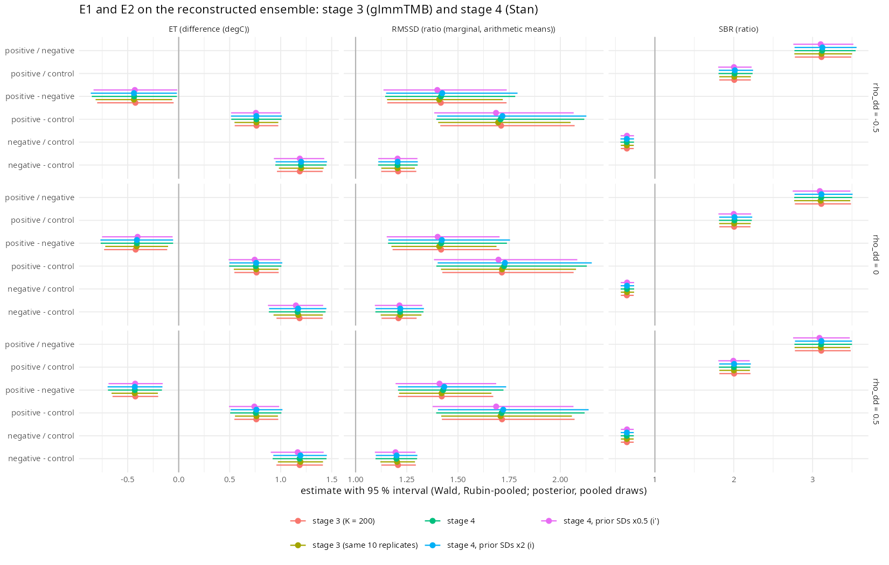
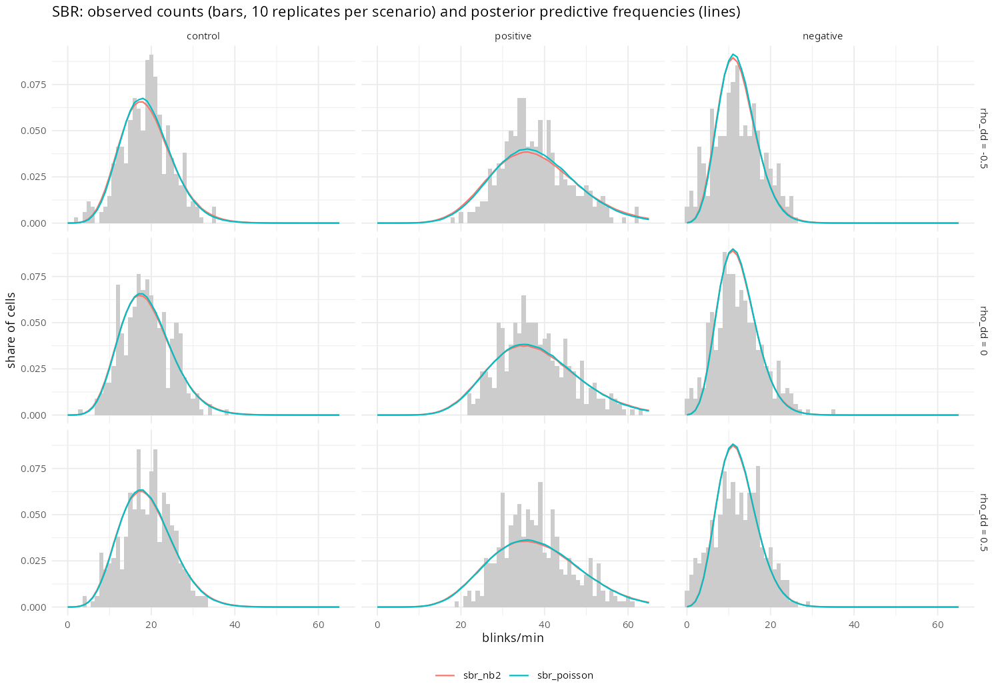

```{r}
#| label: setup
#| message: false
#| warning: false
library(dplyr)
library(tidyr)
library(readr)
library(knitr)
source(here::here("lib/consistency.R"))
art <- here::here("SciRep_emotions_in_working_donkeys_Bukhari_2026")
rd  <- function(p, ...) read_csv(file.path(art, p), show_col_types = FALSE, progress = FALSE, ...)
f   <- function(x, d = 1) formatC(round(x, d), format = "f", digits = d)
ci  <- function(est, lo, hi, d = 1) sprintf("%s [%s, %s]", f(est, d), f(lo, d), f(hi, d))
pf  <- function(p) ifelse(p < 1e-3, sub("e-0?", "e\u2212", formatC(p, format = "e", digits = 0)), formatC(p, format = "f", digits = 3))
# pipe tables in both formats: pandoc wraps wide tables to the page width in PDF, with column widths proportional
# to the header/cell widths, so short headers are padded to a minimum width to keep their column readable
kb  <- function(x, align = NULL, col.names = NULL, min_width = 11) {
  if (!is.null(col.names)) names(x) <- col.names
  names(x) <- formatC(names(x), width = min_width, flag = "-")
  kable(x, format = "pipe", align = align)
}
pct <- function(x, d = 0) paste0(f(100 * x, d), " %")

# numbers as reported in the paper (data/raw/, see EXTRACTION_LOG.md)
t2c <- rd("data/raw/table2_conditions.csv")
t2d <- rd("data/raw/table2_changes.csv")
pv  <- rd("data/raw/text_contrast_pvalues.csv")
reg <- rd("data/raw/tables3_4_regressions.csv")
T2  <- function(o, cnd, w = "mean") t2c[[w]][t2c$outcome == o & t2c$condition == cnd]
D2  <- function(o, t, w = "delta_mean") t2d[[w]][t2d$outcome == o & t2d$treatment == t]
RG  <- function(tab, term, w = "estimate") reg[[w]][reg$table == tab & reg$term == term]

# stage 1: consistency checks on the reported numbers (R/02_consistency_checks.R)
cc <- rd("output/tables/consistency_contrasts.csv")
cd <- rd("output/tables/consistency_deltas.csv")
cg <- rd("output/tables/consistency_grim.csv")
cp <- rd("output/tables/consistency_power.csv")
cr <- rd("output/tables/consistency_regressions_vs_table2.csv")
CC <- function(o, t, w) cc[[w]][cc$outcome == o & cc$treatment == t]

# stage 2: reconstruction (R/04–06)
ex  <- rd("output/tables/contrasts_exact.csv")
rv  <- rd("output/tables/contrasts_reversed_counts.csv")
pn  <- rd("output/tables/contrasts_pos_vs_neg_bounds.csv")
sim <- rd("output/tables/sim_contrasts_summary.csv") |> filter(rho_dd == 0)
gof <- rd("output/tables/gof_model_comparison.csv")
gfs <- rd("output/tables/gof_fit_summary.csv")
grt <- rd("output/tables/gof_residual_tests.csv", col_types = cols(df = col_character()))
EX  <- function(o, t, w) ex[[w]][ex$outcome == o & ex$treatment == t]
PN  <- function(o, w) pn[[w]][pn$outcome == o]
RVR <- function(o, t) { r <- rv$n_reversed[rv$outcome == o & rv$treatment == t]; if (length(r) == 1) as.character(r) else paste(min(r), "to", max(r)) }
GF  <- function(tab, w) gfs[[w]][gfs$table == tab]

# stages 3 and 4 (R/02_fit_frequentist.R, stan/, R/03_postprocess.R)
s3d  <- rd("output/tables/stage3_ensemble_diagnostics.csv")
s3m  <- rd("output/tables/stage3_ensemble_model_comparison.csv")
sbs  <- rd("output/tables/stage4_side_by_side.csv")
conv <- rd("output/tables/stage4_runs_convergence.csv")
mapc <- rd("output/tables/stage4_example_mapping.csv")
ppc  <- rd("output/tables/stage4_ppc_summary.csv")
loo  <- rd("output/tables/stage4_loo_comparison.csv")
e5   <- rd("output/tables/stage4_e5_auc.csv")
S  <- function(o, term, scale, w = "stage4", rho = 0) {
  r <- sbs[sbs$outcome == o & sbs$term == term & sbs$scale == scale & sbs$rho_dd == rho, ]
  r[[w]][1]
}
A  <- function(contrast, quantity, w = "estimate", model = "sbr_nb2", rho = 0) {
  r <- e5[e5$model == model & e5$contrast == contrast & e5$quantity == quantity & e5$rho_dd == rho, ]
  r[[w]][1]
}
PP <- function(model, statistic, cnd, w = "observed_mean", rho = 0) {
  r <- ppc[grepl("^planned", ppc$role) & ppc$prior_scale == 1 & !ppc$pooled & ppc$rho_dd == rho &
           ppc$model == model & ppc$statistic == statistic & ppc$condition == cnd, ]
  r[[w]][1]
}
e12 <- sbs |> filter(estimand %in% c("E1", "E2"), rho_dd == 0)
```

::: {.callout-note appearance="simple"}
**Paper reviewed.** Bukhari S.S.U.H., McElligott A.G., Steagall P.V., Parkes R.S.V. (2026). *Heart rate variability, eye temperature, and spontaneous blink rates as measures of emotions in working donkeys*. Scientific Reports. [10.1038/s41598-026-62753-3](https://doi.org/10.1038/s41598-026-62753-3) [@bukhari2026].
Version: accepted manuscript ("Article in Press", unedited). Protocol version `{r} params$protocol_version`,
track `{r} params$track`. Authors contacted on 2026-10-25 with a data request and notice of this
commentary; a co-author replied on 2026-10-26 and the corresponding author on 2026-11-09 (data under
review by the authors). See [Right of reply](#right-of-reply). A [plain-language primer](primer.qmd)
accompanies this review.
:::

## Summary

::: {.verdict}
**Verdict: conclusions not supported** for the claims that heart-rate variability and eye temperature
discriminate positive from negative emotion, and for the recommendation to "assess donkey emotions using
the change" in each measure. **Major concerns** for the study as a whole.
The six change scores are printed without sign and five of their magnitudes are inconsistent with the
condition means they are defined from; the two exact p-values cannot come from the described models on the
described data; the Discussion states that heart-rate variability fell under the negative treatment when
the Results show it rose; the positive-versus-negative comparison on which every valence claim rests was
never run; nothing independent of the outcomes shows that the two stimuli induced the intended states, and
the positive stimulus is eating. The one claim the reported data do support is that the blink rate moves
in opposite directions under the two treatments at the group level.
:::

The review has three parts. The first (Design to Reporting) applies the appraisal protocol to the text,
tables and figures. The second (Internal consistency) recomputes what can be recomputed from the reported
numbers. The third (Re-analysis) reconstructs the per-donkey data from the published figures and tables,
refits the models the paper describes, and fits a better-specified model both with maximum likelihood and
in Stan. Every number below is produced by code in the repository; the authors' data have been requested
and, when they arrive, the same scripts run on them unchanged.

Each concern carries an evidence tag: *confirmed* (follows from the paper's own numbers), *inferred*
(depends on a stated assumption) or *needs data* (only the raw data or code can settle it).

## What the paper does

Thirty-four working donkeys from Pakistani brick kilns, each recorded in one session under three
conditions in randomised order: control ("standing calmly in their usual living environment"), a positive
treatment (green lucerne in an 8-litre bucket) and a negative treatment (the sound of hair clippers held
close to the right ear). Each condition lasted three minutes, with a one-hour washout. Three outcomes per
condition: spontaneous blink rate (SBR, blinks per minute from video, two coders), eye temperature (ET,
maximum at the medial canthus by infrared thermography) and heart-rate variability as the root mean square
of successive RR differences (RMSSD, three-minute window).

Analysis as described: "Linear mixed-effects models (with an individual donkey as a random effect) were
fitted to individually compare SBR, ET, and HRV (quantified as RMSSD) under the positive or negative
treatment with the control. The order of the treatment application was included in the model as a fixed
effect." Then change scores, "calculated (control minus positive and control minus negative treatment)",
entered two regressions of ΔRMSSD on ΔSBR and on ΔET, each with a treatment term and a donkey random
effect. Table 2 of the paper, as printed:

```{r}
#| label: tbl-table2
#| tbl-cap: "The paper's Table 2 as printed (mean ± SD, n = 34 assumed; no n per cell is stated). The Δ columns are defined in the caption and in Methods as control minus treatment."
t2c |>
  mutate(cell = sprintf("%s ± %s", f(mean, 2), f(sd, 2))) |>
  select(outcome, unit, condition, cell) |>
  pivot_wider(names_from = condition, values_from = cell) |>
  left_join(t2d |> mutate(cell = sprintf("%s ± %s", f(delta_mean, 2), f(delta_sd, 2))) |>
              select(outcome, treatment, cell) |>
              pivot_wider(names_from = treatment, values_from = cell, names_prefix = "Δ "),
            by = "outcome") |>
  kb(col.names = c("Outcome", "Unit", "Control", "Positive", "Negative", "Δ positive", "Δ negative"))
```

The paper concludes that "ET, SBR, and HRV may act as indicators of emotions in donkeys", that SBR "may
provide a simple and practical behavioral indicator" of positive and negative treatment, and proposes
"that instead of considering absolute values for ET, SBR, and HRV, we should assess donkey emotions using
the change in ET, SBR, and HRV".

## Design

**No manipulation check.** Nothing independent of the three outcomes shows that the lucerne induced a
positive state or the clipper a negative one: no behaviour other than blinking, no heart rate, no latency,
no approach or avoidance. The authors note that the study "lacked a comprehensive behavioral investigation
during treatments". The three hypotheses are about the *magnitude* of change in each measure, not its
direction; the reading of SBR and RMSSD as valence markers and of ET as an arousal marker appears for the
first time in the Discussion.

::: {.evidence-confirmed}
Without an independent check, "positive" and "negative" label two stimuli, not two emotional states, and
arousal cannot be separated from valence.
:::

**The positive stimulus is eating.** Chewing, swallowing, a head-down posture into a bucket and altered
respiration change RR intervals, and therefore a three-minute RMSSD; a head in a bucket changes the eye's
visibility and angle for the blink video and for a thermal camera positioned at one metre and 90°. The
Methods say nothing about how the eye was imaged during feeding, and heart rate, respiration and
artefact-correction rates are not reported. The Introduction itself lists heart rate, respiration and
physical activity as confounders of RMSSD.

::: {.evidence-inferred}
Every positive-treatment effect, including the two largest in the paper (SBR and RMSSD), is compatible
with a motor and feeding effect. Whether it is one needs the heart rate, artefact and filming information.
:::

**Order, carryover and allocation.** All three conditions ran in one session with a one-hour washout
after a food reward or a sustained aversive sound. Order is a fixed effect in the models but its estimate
is never reported; carryover is not assessed; randomisation is described as "generating random numbers
between one to three using Microsoft Excel", which is not a permutation of three treatments, and the
number of donkeys per sequence is not given. Order co-varies with time of day and ambient temperature
(SD 4.55 °C across measurements).

**Power calculation.** G*Power with "effect size (ρ = 0.5)", α = 0.05 and power 0.95 gives 34. ρ is a
correlation; the primary analyses are paired contrasts. The figure is reproducible only as G*Power's
point-biserial correlation model, one-sided (block F of the consistency script:
`{r} cp$n_required[cp$test == "correlation, point-biserial model, one-sided"]` donkeys, power
`{r} f(cp$power_at_34[cp$test == "correlation, point-biserial model, one-sided"], 3)` at n = 34); two-sided
it needs `{r} cp$n_required[cp$test == "correlation, point-biserial model, two-sided"]`, a paired t at
d~z~ = 0.5 needs `{r} cp$n_required[cp$test == "paired t, d_z = 0.5, two-sided"]`. At the paper's own
standardised changes, `{r} min(cp$n_required[grepl("own d_z", cp$test)])` to
`{r} max(cp$n_required[grepl("own d_z", cp$test)])` donkeys would have sufficed.

::: {.evidence-confirmed}
The sample size rests on a one-sided correlation test unrelated to the contrasts analysed. This bears on
the relevance of the calculation, not on the results.
:::

**Blinding and pre-registration.** Neither is mentioned. Coders could see the condition on video (bucket,
clipper); thermography reading and analysis were not blinded. The valence/arousal framing is post hoc.

## Measurement

**Construct.** SBR and ET are introduced as *stress* markers ("SBR is a reliable measure of stress in
humans and animals") and read in the Discussion as *valence* markers. No donkey-specific validation
exists, by the paper's own account the first study of its kind.

**SBR is a count.** Figure 1 of the paper shows every inter-coder difference on an integer and every
coder mean on a half-integer grid: SBR per donkey per condition is an integer count. It is analysed as
Gaussian, and the normality check was run "on the data", not on residuals. RMSSD is positive and
right-skewed (Fig. 2C whisker to 132 ms), likewise analysed on the raw scale.

**Change scores.** Δ is defined twice as control minus treatment. Five of the six treatment means exceed
control, so five Δ must be negative under that definition; all six are printed positive (see
[Internal consistency](#internal-consistency)). Both Δ of a donkey subtract the same control value, which
induces correlation between ΔRMSSD and ΔSBR or ΔET through control variability and regression to the
mean; this is not acknowledged.

**Reliability and covariates.** Inter-coder agreement for SBR is given as Bland–Altman bias and limits
printed on Figure 1 only; no reliability for ET or RMSSD. Ambient temperature, humidity and wind were
measured "as they may affect thermography in field conditions" and enter no model. Table 1's title
promises body condition scores; the table has none. Missing data, exclusions and n per analysis are
never stated.

## Model adequacy

- **Family.** A count and a skewed positive quantity modelled as Gaussian; assumptions checked on raw
  outcomes. *Confirmed.*
- **Pooled residual variance.** A linear mixed model with one residual variance gives every contrast of
  an outcome the same standard error, while the Δ SDs of Table 2 differ by a factor of about two between
  treatments (RMSSD `{r} f(D2("RMSSD", "positive", "delta_sd"), 2)` vs
  `{r} f(D2("RMSSD", "negative", "delta_sd"), 2)` ms). The consequence is quantified in the
  [re-analysis](#stage-2-what-the-reconstruction-says-exactly). *Confirmed as a property of the described
  model; its size inferred.*
- **Parallel slopes.** The Δ regressions have no ΔSBR × treatment or ΔET × treatment term, and Figures 3–4
  draw parallel lines. On unsigned changes, one slope pools "larger increase in SBR with larger increase in
  RMSSD" (positive) with "larger decrease in SBR with larger increase in RMSSD" (negative). *Confirmed.*
- **Post-treatment adjustment.** The treatment term of Tables 3–4 is the ΔRMSSD difference between
  treatments after adjusting for ΔSBR or ΔET, which are themselves outcomes of the treatment. The raw
  difference of `{r} f(D2("RMSSD", "positive") - D2("RMSSD", "negative"), 1)` ms becomes
  `{r} f(RG(3, "treatment_positive"), 2)` after ΔSBR and `{r} f(RG(4, "treatment_positive"), 2)` after ΔET,
  and the text presents these as findings about the treatment. *Confirmed.*
- **Multiplicity.** Six contrasts and four regression terms, no adjustment or framing. *Confirmed, minor.*

## Internal consistency

### The change scores

```{r}
#| label: tbl-deltas
#| tbl-cap: "Reported Δ against the definition control minus treatment. With complete pairs the mean Δ must equal the difference of the condition means to within rounding (±0.01 on each mean)."
cd |>
  transmute(Outcome = outcome, Treatment = treatment,
            `Control` = f(ctrl_mean, 2), `Treatment mean` = f(trt_mean, 2),
            `Δ as defined` = f(expected_signed, 2),
            `Feasible magnitude` = sprintf("%s to %s", f(feasible_low, 2), f(feasible_high, 2)),
            `Δ printed` = f(delta_mean, 2),
            Sign = ifelse(sign_consistent, "consistent", "inconsistent"),
            Magnitude = ifelse(magnitude_in_range, "in range", "out of range")) |>
  kb(align = "llrrrrrll")
```

::: {.evidence-confirmed}
Five of six printed Δ have the sign opposite to the definition, and five of six magnitudes lie outside
the range the condition means allow; the largest excess is RMSSD positive,
`{r} f(D2("RMSSD", "positive"), 2)` printed against `{r} f(abs(cd$expected_signed[cd$outcome == "RMSSD" & cd$treatment == "positive"]), 2)` implied.
:::

::: {.evidence-inferred}
Every discrepancy is explained if the printed Δ are the means of the *unsigned* per-donkey changes,
|control − treatment|. All five discrepant cells lie above the feasible range, none below, as the mean of
absolute values must; the one exact cell (SBR positive) is the one in which no donkey could plausibly
have changed in the wrong direction. Tables 3–4 reproduce from the printed Δ (next table), so the
regressions and Figures 3–4 used these unsigned values. The reconstruction in the re-analysis confirms
the reading to the printed digit; it remains inferred because it assumes 34 complete pairs.
:::

```{r}
#| label: tbl-regvs
#| tbl-cap: "Intercepts and treatment terms of Tables 3–4 implied by the printed Δ means and the printed slopes (OLS identities), against the reported values."
cr |>
  transmute(Table = table, Term = term, Reported = f(estimate, 2), `Implied by Table 2 Δ` = f(implied_from_table2, 2),
            Difference = f(difference, 2)) |>
  kb(align = "llrrr")
```

### The p-values

The six condition contrasts are reported as p-values only. From the printed Δ rows with n = 34, the
paired t statistics follow:

```{r}
#| label: tbl-pvalues
#| tbl-cap: "Paired t from the printed Δ mean and SD (n = 34) against the reported p. The Δ-row SD is that of the unsigned changes, which overstates t where donkeys moved against the group direction (see the exact recomputation in the re-analysis); the conclusion does not change."
cc |>
  transmute(Outcome = outcome, Treatment = treatment,
            `Δ ± SD` = sprintf("%s ± %s", f(delta_mean, 2), f(delta_sd, 2)),
            `t (paired)` = f(t_paired, 1), `p from Δ` = pf(p_paired),
            `p reported` = ifelse(p_type == "exact", f(p_reported, 3), paste("<", f(p_reported, 3))),
            `t needed for the reported p` = f(t_needed_df33, 1),
            Verdict = ifelse(p_consistent, "consistent", "inconsistent")) |>
  kb(align = "llrrrrrl")
```

::: {.evidence-confirmed}
The two exact p-values are inconsistent with every summary in the paper. SBR positive needs
t ≈ `{r} f(CC("SBR", "positive", "t_needed_df33"), 1)` for p = `{r} f(CC("SBR", "positive", "p_reported"), 3)`; the
data give `{r} f(CC("SBR", "positive", "t_paired"), 1)`. Even the unpaired worst case gives
t = `{r} f(CC("SBR", "positive", "t_unpaired_welch"), 1)`. A degrees-of-freedom-free version: for both SBR and
RMSSD the contrast with the *larger* t has the *larger* p (SBR `{r} f(CC("SBR", "positive", "t_paired"), 1)` vs
`{r} f(CC("SBR", "negative", "t_paired"), 1)`, p `{r} f(CC("SBR", "positive", "p_reported"), 3)` vs
< `{r} f(CC("SBR", "negative", "p_reported"), 3)`), which two models of the same structure cannot produce.
:::

### GRIM

```{r}
#| label: tbl-grim
#| tbl-cap: "Attainability of reported means with n = 34 (GRIM). SBR is an integer count (Fig. 1); age resolution is not stated."
cg |>
  filter(!grepl("^Δ", what), !grepl("BCS", what)) |>
  transmute(Quantity = what, Reported = f(value, 2), `Nearest attainable` = sprintf("%s / %s", f(nearest_below, 3), f(nearest_above, 3)),
            Verdict = grim_consistent, Assumption = sub(" as stated in `what`", "", assumption)) |>
  mutate(Verdict = ifelse(Verdict %in% c(TRUE, "TRUE", "attainable"), "attainable", "not attainable")) |>
  kb(align = "lrrll")
```

::: {.evidence-inferred}
The negative-condition SBR mean, `{r} f(T2("SBR", "negative"), 2)`, is not attainable with 34 integer counts
(assumes n = 34 for that cell and integer SBR, both supported by the paper); the Figure 1 bias for the same
condition fails in the same way. Either n differs from 34 in that cell, which is nowhere stated, or SBR
is not what Figure 1 shows. The age mean 6.05 years is not attainable at whole- or half-year resolution
(*needs data*: how age was estimated).
:::

### Text against results

::: {.evidence-confirmed}
The Discussion states: "We found an increase in RMSSD in response to positive treatment and a reduction
in HRV in response to negative treatment (stressful situation), which is consistent with previous studies
in horses". Table 2 gives RMSSD `{r} f(T2("RMSSD", "control"), 2)` ms in control and
`{r} f(T2("RMSSD", "negative"), 2)` ms under the clipper, an increase, and Figure 2C marks that contrast
"P < 0.001" with the negative box above control. No reduction of RMSSD under the negative treatment
appears anywhere in the Results. This sentence carries the HRV valence claim.
:::

Further cross-references: wind speed 0.21 m/s in the text and 0.78 km/h in Table 1; the RMSSD negative
p-value appears in Figure 2C only; ΔET is proposed as "the measure of positive and negative emotions" and,
two pages later, "should be interpreted carefully as it increases in both positive and negative
treatment"; the medial-canthus sentence and the "sensitive measure of both physical and emotional stress"
sentence each appear twice.

## Reporting

ARRIVE compliance is claimed. Of the Essential 10, items 3 (exclusions and missing data), 4
(randomisation method and concealment), 5 (blinding) and 10b (effect sizes with confidence intervals for
the condition contrasts) are not met, and no checklist is supplied. The six condition contrasts have no
estimates, intervals, degrees of freedom, n, order estimates or variance components, only p-values.
Heart rate, artefact-correction rates and respiration are not reported for a three-minute RMSSD recorded
during eating. Data are "available from the corresponding author on reasonable request"; no code.

## Do the conclusions follow?

**The positive-versus-negative comparison was never run.** ET rises under both treatments
(`{r} f(D2("ET", "positive"), 2)` vs `{r} f(D2("ET", "negative"), 2)` °C), RMSSD rises under both
(`{r} f(D2("RMSSD", "positive"), 2)` vs `{r} f(D2("RMSSD", "negative"), 2)` ms). The only between-treatment
estimates in the paper are the covariate-adjusted treatment terms of Tables 3–4. The Conclusion says the
differences are "numerically greater"; the Discussion treats them as findings: "the change in ET during
the negative treatment … was greater than positive treatment … Therefore, we propose that absolute ET is a
measure of arousal, whereas change in ET is the measure of positive and negative emotions in donkeys."

::: {.evidence-confirmed}
For ET and RMSSD the two treatments differ, if at all, in the size of a change in the same direction, not
in its direction. A measure that rises under both valences cannot indicate valence without a threshold
the paper does not estimate. The re-analysis below shows that the two treatments do differ on all three
outcomes; that does not turn a same-direction difference in magnitude into a valence marker.
:::

**"Assess donkey emotions using the change."** A change needs a within-animal control measurement, so
the proposal does not remove the need for a baseline; and the printed changes carry no direction, so the
claim that "the direction of change in each variable became more obvious" describes the opposite of what
was done.

**SBR as a "simple and practical" field indicator.** The data support a group-level difference. Whether
a single reading from one donkey says anything about its state is an individual-level question the paper
does not address; the re-analysis estimates it ([E5](#e5-sbr-as-a-single-reading-indicator)).

**Comparative claims.** "Donkeys are not less sensitive than other animals"; the study "challenges the
notion that donkeys are stoic and experience less pain or stress than horses". No other species and no
pain were studied.

## Re-analysis

### Data

The authors' data were requested on 2026-10-25 and are under review by the authors. Everything below
runs on a reconstruction with two parts, each with its own log in `data/derived/`.

1. **Digitised changes.** Figures 3 and 4 plot all 68 unsigned changes per figure (34 per treatment).
   They were recovered from the native rasters embedded in the PDF with a transparency-based point
   detector (`tools/digitise_scatter.py`), and stacks of overlapping points were resolved by the
   constraint that the two figures share ΔRMSSD and by the Table 2 moments (`tools/resolve_stacks.py`,
   `DIGITISATION_LOG.md`). The recovered values reproduce every Δ mean and SD of Table 2 to the printed
   digit and Table 3 to the second decimal by ordinary least squares.
2. **Simulated complete datasets.** Condition-level values are not plotted anywhere. For each outcome,
   per-donkey control values were drawn to match the Table 2 control mean and SD exactly, signs were
   assigned to the unsigned changes from the set of sign patterns compatible with the condition means,
   and control values and changes were paired to the correlations implied by the treatment SDs
   (`SIMULATION_LOG.md`). The one quantity nothing pins down, the correlation between a donkey's two
   changes, is set to −0.5, 0 and 0.5 in three scenarios of 200 replicates each. Results are pooled over
   replicates, so their intervals include the reconstruction uncertainty.

Assumptions carried by everything below: n = 34 complete pairs, Δ computed per donkey on the same values
that enter the condition means, plotting rounding of ΔRMSSD (1 ms) and ΔET (0.1 °C), normal control
values paired through a Gaussian copula. All reconstruction-based results are therefore *inferred*, and
the family question raised by the posterior predictive check is *needs data*.

### Stage 2: what the reconstruction says exactly

The mean of the signed changes is fixed by the condition means and the sum of their squares by the
figures, so the SD of the signed changes, the paired t and the control–treatment correlation follow
without simulation. The signs enter only through the donkeys that moved against the group direction,
whose unsigned changes must add up to a known total.

```{r}
#| label: tbl-exact
#| tbl-cap: "Condition contrasts recomputed exactly from the digitised changes and Table 2. Reversed donkeys: number that moved against the group direction, from the enumeration of admissible sign patterns."
ex |>
  mutate(rev = mapply(RVR, outcome, treatment)) |>
  transmute(Outcome = outcome, Treatment = treatment, `Mean change` = f(mean_d, 2),
            `SD of signed changes` = f(sd_d_signed, 2), `t (paired, df 33)` = f(t_paired_signed, 1),
            p = pf(p_paired_signed), `r(control, treatment)` = f(rho_control_treatment, 2),
            `Reversed donkeys` = rev) |>
  kb(align = "llrrrrrl")
```

::: {.evidence-inferred}
Accounting for reversals lowers the RMSSD t statistics from the Δ-row values (the Δ row is the SD of
unsigned changes) but leaves the two exact p-values inconsistent: RMSSD positive gives
t = `{r} f(EX("RMSSD", "positive", "t_paired_signed"), 1)` where p = 0.005 needs 3.0; SBR positive gives
`{r} f(EX("SBR", "positive", "t_paired_signed"), 1)` where p = 0.002 needs 3.4. Every donkey blinked more
with lucerne; exactly one blinked more under the clipper; `{r} RVR("RMSSD", "positive")` donkeys had lower
RMSSD with lucerne than in control, `{r} RVR("RMSSD", "negative")` lower RMSSD under the clipper.
:::

**Positive versus negative, bounded without pairing.** The mean difference between the two treatments is
known; its SD depends on the unknown correlation between a donkey's two changes.

```{r}
#| label: tbl-posneg
#| tbl-cap: "Positive minus negative treatment, never tested in the paper: t under independent changes and in the worst case (correlation −1)."
pn |>
  transmute(Outcome = outcome, `Positive − negative` = f(mean_pos_minus_neg, 2),
            `t (independent)` = f(t_indep, 1), `p` = pf(p_indep),
            `t (worst case)` = f(t_worst, 1), `p (worst case)` = pf(p_worst)) |>
  kb(align = "lrrrrr")
```

::: {.evidence-inferred}
SBR and RMSSD differ between the two treatments under any pairing; ET differs unless the two changes of a
donkey correlate at `{r} f(PN("ET", "rho_dd_for_p_0.05"), 2)` or below. For ET and RMSSD this is a difference
in the size of a same-direction change.
:::

**The described model, refitted.** The paper's model (condition and order as fixed effects, donkey
random intercept, one residual variance, Satterthwaite p-values) was fitted to 200 simulated complete
datasets per scenario.

```{r}
#| label: tbl-sim
#| tbl-cap: "The described linear mixed model on 200 reconstructed datasets (scenario ρ = 0; the other scenarios move the values monotonically and change no conclusion). Medians over replicates; p max is the largest p in any replicate."
sim |>
  transmute(Outcome = outcome, Contrast = gsub("_", " ", contrast), Estimate = f(estimate_med, 2), SE = f(se_med, 2),
            t = f(t_med, 1), `p (median)` = pf(p_med), `p (max)` = pf(p_max),
            `p reported` = ifelse(is.na(p_reported), "not tested", ifelse(p_type == "exact", f(p_reported, 3), paste("<", f(p_reported, 3))))) |>
  kb(align = "llrrrrrl")
```

::: {.evidence-inferred}
Under the described model no replicate yields p = 0.002 for SBR positive or p = 0.005 for RMSSD positive,
and the two RMSSD p-values come out in the *reverse* order of the paper's (positive far below negative).
The pooled residual variance gives the RMSSD negative contrast a p between
`{r} pf(min(sim$p_med[sim$outcome == "RMSSD" & sim$contrast == "negative_vs_control"]))` and
`{r} pf(sim$p_max[sim$outcome == "RMSSD" & sim$contrast == "negative_vs_control"])`, not < 0.001 as the Figure 2C
bracket states; that bracket is reproduced only by an analysis other than the one described.
:::

**The Δ regressions.** Tables 3–4 reproduce by ordinary least squares on the 68 reconstructed rows, so
the donkey random intercept is effectively zero (*confirmed*). The mean structure is adequate; the error
model is not:

```{r}
#| label: tbl-gof
#| tbl-cap: "Residual diagnostics of the Tables 3–4 models on the reconstructed changes."
grt |>
  transmute(Table = table, Test = gsub("|studentised residual|", "abs(studentised residual)", test, fixed = TRUE), Statistic = f(statistic, 2), df = ifelse(is.na(df), "", df), p = pf(p)) |>
  kb(align = "llrrr")
```

The residual SD is `{r} f(GF(3, "resid_sd_positive") / GF(3, "resid_sd_negative"), 1)` times larger in the
positive than in the negative treatment (ΔSBR model), the ΔET model predicts negative changes for
`{r} GF(4, "n_fitted_below_0")` donkeys, and the treatment dummy alone accounts for
R² = `{r} f(GF(3, "r2_treatment_only"), 2)` of the models' `{r} f(GF(3, "r2"), 2)` and
`{r} f(GF(4, "r2"), 2)`. A treatment-specific variance or a Gamma model improves AICc by
`{r} f(gof$dAICc[gof$table == 3 & grepl("^M1", gof$model)], 0)` and
`{r} f(gof$dAICc[gof$table == 4 & grepl("^M1", gof$model)], 0)` units with the same leave-one-out error,
so the standard errors and p-values of Tables 3–4 are not calibrated (*inferred*).

### Stages 3 and 4: a better-specified model, twice

The plan (`notes/04_analysis_plan.md`) was written before fitting and specifies, for each outcome, one
likelihood, one fixed and random structure, the contrasts and the estimands, so that the maximum-likelihood
fit (glmmTMB, stage 3) and the Stan fit (CmdStan, stage 4) are the same model with two inference engines.

- **SBR**: negative binomial (NB2, log link), condition and order fixed, donkey random intercept on the
  log scale. Poisson as sensitivity.
- **ET**: the three condition values of a donkey as one multivariate normal vector with an unstructured
  3 × 3 covariance (condition-specific SDs and within-donkey correlations); order fixed.
- **RMSSD**: the same on the log scale (log-normal MVN); Gamma with condition-specific dispersion as
  sensitivity.
- **E4**: ΔRMSSD on the *signed* ΔSBR and ΔET, one line per treatment, treatment-specific residual SD.
- Estimands: E1 each treatment minus control, E2 positive minus negative, E3 the donkey-level structure,
  E4 the within-treatment slopes, E5 SBR as a single-reading classifier.
- Priors: weakly informative, scaled to the outcome (plan §5); every prior SD doubled and halved as
  sensitivity. Prior predictive checks before any posterior was seen.

Stage 3 ran on all 600 replicates with Rubin's rules for pooling; stage 4 on 10 replicates per scenario
(`{r} nrow(conv)` CmdStan runs, including the sensitivities), with draws stacked over replicates.
All `{r} nrow(conv)` runs pass the pre-specified thresholds (maximum R-hat `{r} f(max(conv$max_rhat), 3)`,
minimum bulk effective sample size `{r} f(min(conv$min_ess_bulk), 0)`, no divergent transitions, minimum
E-BFMI `{r} f(min(conv$min_ebfmi), 2)`). On the example replicate, `{r} sum(mapc$within_1se, na.rm = TRUE)` of
`{r} sum(!is.na(mapc$diff_in_se))` posterior medians lie within one standard error of the glmmTMB estimate.

```{r}
#| label: tbl-sbs
#| tbl-cap: "E1 and E2 on the reconstructed ensemble, scenario ρ = 0 (the other scenarios agree to the digits shown). Stage 3: glmmTMB, Wald 95 % intervals, Rubin-pooled over 200 replicates. Stage 4: Stan, posterior median and 95 % interval, draws pooled over 10 replicates. Width ratio: stage 4 interval over stage 3 interval."
e12 |>
  filter(scale %in% c("difference (blinks/min)", "ratio", "difference (degC)", "difference (ms, marginal)", "ratio (marginal, arithmetic means)")) |>
  mutate(outcome = factor(outcome, levels = c("SBR", "ET", "RMSSD"))) |>
  arrange(outcome, estimand, term, scale) |>
  transmute(Outcome = outcome, Contrast = term,
            Scale = recode(scale, "difference (blinks/min)" = "blinks/min", "ratio" = "ratio", "difference (degC)" = "°C",
                           "difference (ms, marginal)" = "ms", "ratio (marginal, arithmetic means)" = "ratio"), `Paper` = ifelse(is.na(authors_reported), "", sub(",? P [<=] ?0\\.\\d+$", "", gsub("|delta|", "unsigned Δ", authors_reported, fixed = TRUE))),
            `Stage 2 (exact)` = ifelse(is.na(stage2_exact), "", stage2_exact),
            `Stage 3 (glmmTMB)` = stage3, `Stage 4 (Stan)` = stage4, `Width ratio` = f(width_ratio, 2)) |>
  kb(align = "llllllll")
```

{#fig-forest}

::: {.evidence-inferred}
The two engines agree. Over the `{r} nrow(e12)` E1 and E2 rows of the ρ = 0 scenario the posterior medians
differ from the maximum-likelihood estimates by at most
`{r} f(max(abs(e12$s3_10_s4_diff_in_sd), na.rm = TRUE), 2)` posterior SD, and the posterior intervals are
`{r} f(min(e12$width_ratio, na.rm = TRUE), 2)` to `{r} f(max(e12$width_ratio, na.rm = TRUE), 2)` times the Wald
widths. Doubling or halving every prior SD, Poisson instead of negative binomial, Gamma instead of
log-normal and a pooled dispersion change no conclusion. The substantive results: SBR
`{r} S("SBR", "positive - control", "difference (blinks/min)")` blinks/min higher with lucerne and
`{r} S("SBR", "negative - control", "difference (blinks/min)")` lower under the clipper, a ratio of
`{r} S("SBR", "positive / negative", "ratio")` between the two treatments; ET
`{r} S("ET", "positive - control", "difference (degC)")` and `{r} S("ET", "negative - control", "difference (degC)")` °C
higher under lucerne and clipper, positive minus negative `{r} S("ET", "positive - negative", "difference (degC)")`;
RMSSD `{r} S("RMSSD", "positive - control", "difference (ms, marginal)")` and
`{r} S("RMSSD", "negative - control", "difference (ms, marginal)")` ms higher, positive minus negative
`{r} S("RMSSD", "positive - negative", "difference (ms, marginal)")` ms.
:::

**E3, the donkey-level structure.** The SBR latent intraclass correlation is
`{r} S("SBR", "ICC (latent)", "link")`. For ET the within-donkey correlations between conditions are
`{r} S("ET", "corr(positive, negative)", "link")` to `{r} S("ET", "corr(control, positive)", "link")`; for RMSSD
the control–negative correlation is `{r} S("RMSSD", "corr(control, negative)", "link")` while the
correlations involving the positive condition are `{r} S("RMSSD", "corr(control, positive)", "link")` and
`{r} S("RMSSD", "corr(positive, negative)", "link")`: a donkey's RMSSD while eating has little to do with its
RMSSD otherwise, which is what a feeding-driven change would look like (*inferred*). The order terms are
all near zero with intervals that include it.

**E4, the slopes within treatment.** On the signed changes the common slopes of Tables 3–4 do not hold:

```{r}
#| label: tbl-e4
#| tbl-cap: "ΔRMSSD regressed on the signed ΔSBR and ΔET, one line per treatment (scenario ρ = 0). Stage 3 Wald and stage 4 posterior intervals."
sbs |>
  filter(estimand == "E4", rho_dd == 0, grepl("^b", term)) |>
  transmute(Regressor = sub("E4 \\(x = d(\\w+)\\)", "Δ\\1", outcome), Quantity = term,
            Paper = ifelse(is.na(authors_reported), "", authors_reported),
            `Stage 3` = stage3, `Stage 4` = stage4) |>
  kb(align = "lllll")
```

{#fig-e4}

::: {.evidence-inferred}
The ΔRMSSD–ΔSBR relation is positive under lucerne
(`{r} S("E4 (x = dSBR)", "b (slope), positive", "response")` ms per blink/min) and negative under the clipper
(`{r} S("E4 (x = dSBR)", "b (slope), negative", "response")`), difference
`{r} S("E4 (x = dSBR)", "b positive - b negative, positive - negative", "response")`. The paper's single slope of
`{r} f(RG(3, "dSBR"), 2)` on unsigned values averages two relations of opposite sign. For ΔET both slopes are
negative (`{r} S("E4 (x = dET)", "b (slope), positive", "response")` and
`{r} S("E4 (x = dET)", "b (slope), negative", "response")`) and differ twofold. The residual SD is
`{r} f(S("E4 (x = dSBR)", "s (residual SD), positive", "response", "s4_estimate") / S("E4 (x = dSBR)", "s (residual SD), negative", "response", "s4_estimate"), 1)`
times larger in the positive treatment (ΔSBR model) and
`{r} f(S("E4 (x = dET)", "s (residual SD), positive", "response", "s4_estimate") / S("E4 (x = dET)", "s (residual SD), negative", "response", "s4_estimate"), 1)`
times (ΔET model).
:::

**Posterior predictive check and the family question.** The planned models recover every condition mean
and every mean unsigned change. They do not recover some second moments:

```{r}
#| label: tbl-ppc
#| tbl-cap: "Posterior predictive statistics outside the central 95 % of the predictive in more than 10 % of replicates (planned models, scenario ρ = 0). Observed: mean over the 10 replicates; reference: Table 2 or Figure 2C value where one exists."
ppc |>
  filter(grepl("^planned", role), prior_scale == 1, !pooled, rho_dd == 0, share_outside_95 > 0.1) |>
  transmute(Model = recode(model, "rmssd_lognormal_mvn" = "RMSSD log-normal", "sbr_nb2" = "SBR NB2"),
            Statistic = gsub("|delta|", "unsigned Δ", statistic, fixed = TRUE), Condition = condition, Observed = f(observed_mean, 2),
            Reference = ifelse(is.na(reference), "", f(reference, 2)),
            `Predictive median` = f(pred_q50_median, 2),
            `Predictive 95 %` = sprintf("%s to %s", f(pred_q025_median, 1), f(pred_q975_median, 1)),
            `Replicates outside` = pct(share_outside_95)) |>
  kb(align = "lllrrrrr")
```

{#fig-ppc-sbr}

::: {.evidence-needs-data}
The spread of the SBR changes and the RMSSD upper tail in the positive condition are narrower in the
reconstruction than any count or log-normal model with a shared donkey intercept produces (SBR SD of
|Δ| `{r} f(PP("sbr_nb2", "sd |delta|", "negative"), 2)` and `{r} f(PP("sbr_nb2", "sd |delta|", "positive"), 2)`
against predictive medians `{r} f(PP("sbr_nb2", "sd |delta|", "negative", "pred_q50_median"), 1)` and
`{r} f(PP("sbr_nb2", "sd |delta|", "positive", "pred_q50_median"), 1)`). The reconstruction is Gaussian by
construction and fixes the within-donkey coupling, so this is read as a property of the reconstruction,
not as evidence against the families; the maximum-likelihood comparison says the same (a raw-scale
Gaussian model wins AICc in `{r} pct(s3m$share_best_aicc[s3m$rho_dd == 0 & s3m$outcome == "SBR" & grepl("raw-scale", s3m$model)])`
of SBR replicates). glmmTMB could not identify the negative-binomial dispersion on the reconstructed
counts (Poisson fallback in `{r} pct(s3d$share_poisson_fallback[s3d$rho_dd == 0 & s3d$outcome == "SBR"])` of
replicates at ρ = 0); the Bayesian model samples under its prior and agrees with it. Only the authors'
data can decide the family; the check is rerun unchanged on them.
:::

Leave-one-donkey-out comparisons (`stage4_loo_comparison.csv`) are reliable for the multivariate-normal
programs and E4 and indicative only for the programs with a sampled donkey intercept; the Gamma RMSSD
model predicts `{r} f(abs(loo$mean_elpd_diff[loo$rho_dd == 0 & loo$model == "rmssd_gamma" & !loo$pooled]), 0)` elpd
worse than the log-normal, the other alternatives are within about two elpd of the planned models.

### E5: SBR as a single-reading indicator

The paper proposes SBR as a field indicator "without the requirement for sophisticated equipment". The
relevant question is then: given one reading from one donkey of unknown baseline, how well does it
separate the conditions? From the posterior of the SBR model, with new donkeys simulated from the fitted
between-donkey spread:

```{r}
#| label: tbl-e5
#| tbl-cap: "Area under the ROC curve (probability that a reading from condition A exceeds one from condition B, ties half) and the best single threshold, from the negative-binomial SBR posterior pooled over 10 replicates (scenario ρ = 0). Different donkeys: the two readings come from two donkeys (field use). Same donkey: paired design. Typical donkey: the plan's definition, donkey effect at zero."
e5 |>
  filter(model == "sbr_nb2", rho_dd == 0) |>
  mutate(cell = ifelse(grepl("threshold \\(", quantity), sprintf("≥ %s (%s to %s)", f(estimate, 0), f(ci_low, 0), f(ci_high, 0)),
                       ci(estimate, ci_low, ci_high, 2)),
         quantity = recode(quantity, "AUC, different donkeys" = "AUC, different donkeys", "AUC, same donkey" = "AUC, same donkey",
                           "AUC, typical donkey (u = 0)" = "AUC, typical donkey",
                           "best threshold (reading >= t called A)" = "Threshold (blinks/min)",
                           "sensitivity at best threshold" = "Sensitivity", "specificity at best threshold" = "Specificity",
                           "Youden J at best threshold" = "Youden J")) |>
  filter(quantity != "Youden J") |>
  select(contrast, quantity, cell) |>
  pivot_wider(names_from = quantity, values_from = cell) |>
  rename(Contrast = contrast) |>
  kb(align = "lllllll")
```

::: {.evidence-inferred}
A single reading separates lucerne from clipper almost perfectly (AUC
`{r} f(A("positive vs negative", "AUC, different donkeys"), 2)`) and lucerne from control well
(`{r} f(A("positive vs control", "AUC, different donkeys"), 2)`). It separates control from clipper only
moderately: AUC `{r} f(A("control vs negative", "AUC, different donkeys"), 2)`, and at the best cut-off of
`{r} f(A("control vs negative", "best threshold (reading >= t called A)"), 0)` blinks/min about one reading in
four is misclassified either way (sensitivity `{r} f(A("control vs negative", "sensitivity at best threshold"), 2)`,
specificity `{r} f(A("control vs negative", "specificity at best threshold"), 2)`). "A decrease in SBR may
indicate a stressful situation" is true at the group level; as a field tool for one animal the
clipper-versus-calm distinction is the weak one. The observed cross-donkey Mann–Whitney values on the
reconstructed data agree with the model within 0.01.
:::

## What would settle the open points

The data request of 2026-10-25 asked for: per-donkey values of SBR, ET and RMSSD in each condition
with the sign of each change; the order of conditions per donkey; the n per analysis and any exclusions;
heart rate, artefact-correction percentage and respiration per recording; ambient covariates per
recording; the filming and thermography protocol during feeding; the model output (estimates, intervals,
degrees of freedom, variance components) behind the six p-values; and the analysis code. With these,
every script in the repository runs unchanged, the reconstruction becomes a check rather than the
basis, the family question is decided by the posterior predictive check on real counts, and the
evidence tags above can be upgraded or the concerns withdrawn.

## Minor

Multiplicity unaddressed; whether six two-condition or three three-level models were fitted is not
stated; "SBR decreases in response to a stressful or startling situation" generalises from one stimulus,
one exposure and one window; the horse-style SBR rebound "was not observed" although no time course was
examined; habituation was judged by the primary outcome "staying constant" without a numeric criterion;
Bland–Altman limits are printed on Figure 1 only and no reliability is given for ET or RMSSD; duplicated
sentences and a near-duplicate future-work passage; "Band-Altman"; reference 19 pairs a web page with an
unrelated 1998 journal DOI.

## Right of reply

Data request and notice of this commentary sent to both corresponding authors, with the co-authors in
copy, on 2026-10-25. A co-author replied on 2026-10-26 and deferred to the corresponding authors on the
data. The corresponding author replied on 2026-11-09: the request had been filtered to spam; "We will
discuss and review the data, and get back to you as soon as possible." Acknowledged the same day, with
the offer that per-animal values received by the end of November 2026 would replace the reconstruction,
more time on request, and the confirmation that the full text would be sent before publication. The
full text, this review and the primer as PDF files with a summary of the five main points, was sent to
all four authors on 2026-11-19, with publication proposed on or after 2026-12-11, the authors' reply to
be published in full alongside, and more time on request.

<!-- TODO before publication: reply received on YYYY-MM-DD and reproduced here with permission /
summarised; changes made to the review in response; or no reply by the proposed date. -->

## Reproducibility

All numbers above are produced by the code in
`SciRep_emotions_in_working_donkeys_Bukhari_2026/` of the
[repository](https://github.com/albertoalamia/articles_reviews):

- reported numbers: `R/02_consistency_checks.R`, from the files in `data/raw/` (`EXTRACTION_LOG.md`);
- digitisation: `tools/digitise_scatter.py`, `tools/resolve_stacks.py`, `R/04_reconcile_digitised.R`;
- stage 2: `R/05_gof_authors_models.R`, `R/06_condition_contrasts.R`, `R/lib_simulate_conditions.R`,
  logs in `data/derived/`;
- stage 3: `R/01_prepare_data.R`, `R/02_fit_frequentist.R`;
- stage 4: `stan/*.stan`, `run_all.sh`, `R/03_postprocess.R`;
- the specification shared by stages 3 and 4, with every deviation logged: `notes/04_analysis_plan.md`.

Environment pinned in `shell.nix` (R 4.4.3, glmmTMB, CmdStan 2.36.0). Posterior draws are not in the
repository (7 GB); every summary table is.
